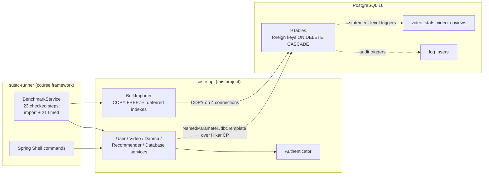

# Video-Sharing Platform Database System

**English** | [中文](README.zh-CN.md)

A PostgreSQL backend for a Bilibili-style video-sharing platform: users, videos, danmu (time-synced comments), likes / coins / favorites, follow relations, search and recommendations. Java 17, Spring Boot 2.7, hand-written SQL over JDBC (no ORM). It implements the service interfaces of a course framework, whose 23-step benchmark checks every answer and times the import and 21 of the other 22 steps.

**Results** (one machine, one PostgreSQL 16 server; the original implementation and this version ran alternately, 3 runs each, on one boot; medians; [methodology](#methodology)):

- Passes **all 5,622** benchmark cases; the original implementation passed 5,618.
- The 10 read and recommendation steps: **20.0 s → 1.09 s (18.3×)**. Similar videos and general recommendations > 100×, personalized recommendations 32× (mostly through the general-recommendation fallback for users without friends), friend recommendations 22×, search 4.6×.
- The 11 write steps: **3.29 s → 3.77 s, 14.5 % slower** (round 2: 17.8 %, though the original's own sum moved from 2.85 to 3.29 s between the two series); [the write path](#the-write-path) measures where the time goes.
- All 21 timed steps together: **23.3 s → 4.9 s (4.8×)**. Data import (≈ 8.2 M rows): **103.4 s → 9.6 s (10.7×)**.
- Under concurrency ([WriteBench](#the-write-path), stress mode, 45 trials each): coin overspending in 45 of 45 trials in the original → 0 of 45, lost like and follow toggles 45/45 → 0/45, crossing account deletions failing 4/45 with the round-1 code → 0/45. On 8 clients no deletion fails any more: 0 of 300 account deletions and 0 of 24 deletions of imported videos, where round 2 lost 79–83 of 100 and 4–6 of 8 to deadlocks. Account deletions now run one at a time, at 29 % of the original's throughput on 8 clients ([known limitations](#known-limitations)).
- 144 tests (JUnit 5; 110 of them integration tests against PostgreSQL 16 in Testcontainers), passing on JDK 21 and, in an `eclipse-temurin:17-jdk` container, on JDK 17, in a fresh clone ([ci-proof.txt](docs/experiments/ci-proof.txt)). The CI workflow runs the same build on both, but has not run on GitHub yet.

By the medians, eleven steps are slower than before, by 2–147 ms each: nine of the eleven writes (coin and register got faster) and the two cheapest reads (hotspots 13 → 23 ms, danmu display 46 → 89 ms). For hotspots, post video, update video, review, delete video, delete account and follow, the ranges of the two versions overlap.

> The interfaces in `io.sustc.service`, the DTOs in `io.sustc.dto` and the whole `sustc-runner` module (shell and benchmark) come from an MIT-licensed course framework (see [LICENSE](LICENSE)); the benchmark logic and data are unchanged. This project's work is `sustc-api/src/main/java/io/sustc/service/impl/`, the SQL in `sql/`, the tests, the scripts and the documentation.

## Contents

- [Architecture](#architecture)
- [Database design](#database-design)
- [Performance](#performance)
- [Correctness](#correctness)
- [Running it](#running-it)
- [Limits and safety](#limits-and-safety)
- [Known limitations](#known-limitations)

Deeper notes, one section per change with the key EXPLAIN plans: [docs/ENGINEERING_NOTES.md](docs/ENGINEERING_NOTES.md).

## Architecture



- **Services** are Spring beans with constructor injection (`NamedParameterJdbcTemplate`, `Authenticator`, `Clock`); a REST layer can reuse them under the conditions in [HANDOFF.md](HANDOFF.md#adding-a-rest-layer). The `Clock` makes "now" testable; the benchmark pins it to the time its data was generated.
- **Every write is one call.** Coin donations, reviews, edits and cascading deletes are single statements (data-modifying CTEs, `ON CONFLICT`, foreign-key cascades); a toggle is an advisory lock on the acting user plus the toggle statement, sent in one round trip. Each call is atomic without an explicit transaction. Concurrent calls are covered by tests: toggles of one user are serialized, so none is lost; an edit locks its row before it reports the review state it replaced; co-view counts lock the viewer; deletions that change derived rows take a deletion lock first (an advisory lock sent in the same round trip), so two of them never run into each other; and a call that loses a deadlock anyway is retried (up to 3 attempts).
- **Derived data lives in the database.** Per-video counters (`video_stats`) and co-viewing counts (`video_coviews`) are kept up to date by statement-level triggers, so recommendations read a few dozen rows instead of aggregating 2.2 M interaction rows per call.
- **The importer** bulk-loads with `COPY`, rebuilds indexes and constraints afterwards from the catalog, and if anything fails leaves the imported tables empty with the complete schema (the `users` audit log keeps the attempt).

## Database design

Schema: [`sql/build.sql`](sql/build.sql). Audit log: [`sql/audit.sql`](sql/audit.sql). Roles and privileges: [`sql/usercontrol.sql`](sql/usercontrol.sql).


**Conventions.** Each relation table is keyed by `(object, user)`, so "has user U liked video V?" is a primary-key probe. Foreign keys cascade on delete (except into the derived `video_coviews`, whose rows a trigger deletes), so deleting a user or a video removes everything that refers to it in the same statement (the original code left danmu likes and some interactions behind). Real values are `double precision`, so sums are not accumulated in `float4`. Ids come from identity columns, which the importer moves past the imported ids. Empty QQ / WeChat ids are stored as `NULL`, so the unique constraints only apply to users who have one.

**Indexes and what they are for.** Every index below was chosen for a specific query; the plans are in [docs/explain](docs/explain).

| Index | Serves |
|---|---|
| `followings (follower_mid, followee_mid)` PK | whom a user follows; mutual-follow check |
| `followings (followee_mid, follower_mid)` | followers of a user; friend recommendations probe it once per followee as an index-only scan (the original plan scanned all 6 M rows) |
| `viewers / videolikes / coins / favorites (bv, mid)` PK | "did U watch / like … V", per-video lists |
| `… (mid, bv)` on the same four tables | everything a user did (user info, account deletion cascades, friends' views) as index-only scans |
| `videos (owner_mid, title)` unique | the spec's "same title for the same user" rule; also the owner's videos |
| `danmus (bv, time)` | danmu in a time range of a video, in order |
| `danmus (mid)`, `danmulikes (mid)`, `videos (reviewer)` | cascades when a user is deleted |
| `video_coviews (bv, other_bv)` PK, `(other_bv)` | similar videos: one index lookup of the video's co-viewing rows, then a top-5 sort; deleting a video's rows in both directions |

**Derived tables.** `video_stats` holds per-video counts and the sum of view times; `video_coviews` holds, for every ordered pair of videos, the number of users who watched both. Statement-level `AFTER` triggers with transition tables apply the change of a whole statement as one `INSERT … ON CONFLICT DO UPDATE` (or one `DELETE`/`UPDATE` for co-views), in key order, so two firings of one trigger take the row locks they share in the same order. That order holds within one trigger only: a delete that cascades fires one trigger per cascaded table, so two concurrent cascading deletes could lock in crossing orders and deadlock. Deletions therefore take a deletion lock first (an advisory lock: exclusive for an account with interactions or videos, shared for a video), and `video_coviews` has no foreign keys: the delete trigger on `videos` locks and deletes a video's co-view rows in both directions in one pass in key order. The importer computes both tables in Java from the records and loads them with `COPY` like the other tables. A test replays a seeded random workload of service calls and multi-row SQL and compares both tables with a recomputation from scratch.

**Audit and roles.** `audit.sql` records every insert, update and delete on `users` (with the database role and time) through statement-level triggers. `usercontrol.sql` creates three roles with decreasing privileges, including what the derived-table triggers need, since triggers run with the invoking role's privileges.

## Performance

### Results

<!-- benchmark-table:start -->
| Step | Baseline ms (n=3) | Optimized ms (n=3) | Speedup | Passed (baseline → optimized) |
|---|---:|---:|---:|---:|
| 1 import | 103,387 [101,273–106,993] | 9,648 [9,335–9,816] | **10.7×** | – |
| 2 search | 313 [282–340] | 68 [56–72] | **4.6×** | 18 → 20 / 20 |
| 3 view rate | 55 [52–59] | 17 [16–19] | **3.2×** | 60 → 61 / 61 |
| 4 hotspot | 13 [12–20] | 23 [17–24] | 0.57× | 56 → 56 / 56 |
| 5 similar videos | 2,444 [2,249–3,036] | 18 [15–21] | **135.8×** | 43 → 43 / 43 |
| 6 general rec | 1,025 [1,023–1,621] | 6 [5–9] | **170.8×** | 11 → 11 / 11 |
| 7 user rec | 1,977 [1,949–2,474] | 62 [55–65] | **31.9×** | 27 → 27 / 27 |
| 8 friend rec | 13,694 [12,493–14,549] | 616 [609–661] | **22.2×** | 142 → 142 / 142 |
| 9 danmu display | 46 [43–54] | 89 | 0.52× | 382 → 382 / 382 |
| 10 danmu send | 228 [218–240] | 322 [299–387] | 0.71× | 1016 → 1016 / 1016 |
| 11 user info | 330 [276–365] | 183 [129–202] | **1.8×** | 500 → 500 / 500 |
| 12 danmu like | not timed | not timed | – | 500 → 500 / 500 |
| 13 coin | 636 [566–676] | 569 [560–724] | **1.1×** | 511 → 511 / 511 |
| 14 like | 636 [534–657] | 743 [742–1,006] | 0.86× | 686 → 686 / 686 |
| 15 collect | 569 [539–584] | 716 [618–741] | 0.79× | 644 → 644 / 644 |
| 16 post video | 58 [39–69] | 68 [58–71] | 0.85× | 184 → 184 / 184 |
| 17 register | 121 [90–124] | 112 [86–113] | **1.1×** | 273 → 273 / 273 |
| 18 update video | 22 [22–30] | 30 [22–32] | 0.73× | 184 → 184 / 184 |
| 19 review | 23 [19–23] | 26 [20–38] | 0.88× | 35 → 35 / 35 |
| 20 search after update | 136 [105–173] | 11 [9–14] | **12.4×** | 5 → 6 / 6 |
| 21 delete video | 492 [444–586] | 635 [569–666] | 0.77× | 55 → 55 / 55 |
| 22 delete account | 451 [427–478] | 490 [409–491] | 0.92× | 199 → 199 / 199 |
| 23 follow | 58 [51–59] | 60 [55–70] | 0.97× | 87 → 87 / 87 |
| **Read steps 2–9, 11, 20 (sum)** | **20,033** | **1,093** | **18.3×** | |
| **Write steps 10, 13–19, 21–23 (sum)** | **3,294** | **3,771** | 0.87× | |
| **All 21 timed steps (sum)** | **23,327** | **4,864** | **4.8×** | |
| **All test cases** | | | | **5618 → 5622 / 5622** |
<!-- benchmark-table:end -->

Generated by `python3 scripts/bench_table.py --write README.md README.zh-CN.md` from the raw reports in [docs/benchmark/round3/plain](docs/benchmark/round3/plain) (`c6-B<i>.json`: the original implementation; `c6-O<i>.json`: this version; run order B1, O1, B2, O2, B3, O3). Times are the median of 3 runs with the range in brackets; speedups divide the two medians. Step 12 is not timed by the framework. The harness's `compare.py` gives the same medians ([compare.txt](docs/benchmark/round3/plain/compare.txt)), and [report.txt](docs/benchmark/round3/plain/report.txt) has the per-run sums, the WAL of every write step and the checkpoints around them. Round 2's series (jar sha256 `42004a16…`) is in [docs/benchmark/round2/plain](docs/benchmark/round2/plain) (read steps 19,057 → 1,080 ms, write steps 2,846 → 3,353 ms, all 21,903 → 4,433 ms).

The earlier runs in [docs/benchmark/round1](docs/benchmark/round1) ran the two versions one after the other, hours apart, and are no longer quoted. The original implementation got slower from round to round (its import took 57.7 s in round 1, 90.4–93.2 s in round 2 and 101.3–107.0 s in round 3; this version's 8.2–8.9 s in round 2 and 9.3–9.8 s here); why was not measured, which is one reason the versions alternate. The older `original-result.json` and `reference-standard.json` in [docs/benchmark](docs/benchmark) are from 2023 and another machine and are not used.

### What made the difference

The plans before and after are in [docs/explain](docs/explain) (`EXPLAIN (ANALYZE, BUFFERS)`, one run each, regenerated by `scripts/explain_plans.sh`). Their per-node timing inflates plans that produce many rows (on a 638 k-row join and aggregation it reported 200–205 ms, against 129–133 ms with `TIMING OFF` and 122–124 ms run plainly, three runs each: [docs/experiments/explain-overhead.txt](docs/experiments/explain-overhead.txt)), so the table takes the row counts from those plans and the times from the benchmark (step medians, original → this version).

| Change | Effect |
|---|---|
| Co-viewing counts kept in `video_coviews` | Similar videos: the original self-joins the 875 k-row `viewers` table on every call; now it reads the video's 43 co-viewing rows from an index and sorts them for the top 5. Step 5: 2,444 → 18 ms. |
| Per-video counters kept in `video_stats` | General recommendations: the original aggregates each of the five interaction tables (2.2 M rows in all) on every call; now it joins two 44-row tables. Step 6: 1,025 → 6 ms. Users without friends fall back to it, so personalized recommendations gain too: step 7: 1,977 → 62 ms. |
| Covering index `followings (followee_mid, follower_mid)` and a rewritten friend query | Step 8: 13,694 → 616 ms. With `VACUUM ANALYZE` run right after its import, the original still took 11.4–12.2 s with the same plan in round 2 ([analyze runs](docs/benchmark/round2/analyze)), so missing statistics do not explain its time here. |
| Search counts non-overlapping occurrences with `replace()` and reads view counts from `video_stats` | Step 2: 313 → 68 ms. The original joined every view of every matching video and used the keywords as regular expressions. |
| Bulk import with `COPY … FREEZE`, indexes and constraints built afterwards, foreign keys validated in parallel, `VACUUM (ANALYZE)` at the end | Step 1: 103.4 s → 9.6 s; phases (median of the 3 runs): load 2.8 s, indexes 5.1 s, constraints 1.5 s, vacuum/analyze 0.2 s. |

### The write path

The 11 write steps take 3,294 ms in the original and 3,771 ms here (sums of the step medians; the per-run sums are 3,025–3,451 and 3,594–4,301 ms, [report.txt](docs/benchmark/round3/plain/report.txt)). Collect (+147 ms), delete video (+143), like (+107) and danmu send (+94) make up most of the difference; coin (−67) and register (−9) are faster. Round 1 put the gap down to the timing after the import; round 2 measured that ([round-2 report](docs/benchmark/round2/plain/report.txt), [settle runs](docs/benchmark/round2/settle/report.txt); details in the [engineering notes](docs/ENGINEERING_NOTES.md#the-write-path)):

- **Not writeback.** When step 10 starts, the kernel holds 0.6–1.6 MB of dirty data in this version's runs and 0.6–35.7 MB in the original's (round 2: 1.1–2.0 and 63–90 MB).
- **The checkpoint after the import: about 5 % (round 2).** With a `CHECKPOINT` and a wait after the import (the settle variant), the write steps took 3,189 ms here and 2,892 ms in the original; the per-run sums overlap with those of the plain runs.
- **Full-page images: about the same in both versions**, except danmu send (122 kB → 2,307 kB of WAL). Its foreign key into `users` locks each sender's row, and the first lock on a page after a checkpoint writes an image of that page to the WAL ([fk-lock-wal.txt](docs/experiments/fk-lock-wal.txt)).
- **The rest is work per call.** WriteBench runs each write operation through the service layer of either jar, on the benchmark data, after a `CHECKPOINT` and 300 warm-up calls: 600 calls per operation, 3 alternating runs per version and client count ([round-3 summary](docs/benchmark/round3/writebench/summary.md); round 2's 5 runs are in [its summary](docs/benchmark/round2/writebench/summary.md)). Median p50 in ms, original → this version; this version's 8-client throughput divided by the original's; and the statements and round trips per call, counted from the JDBC driver's messages:

| Operation | 1 client | 8 clients | 8 clients, throughput this version / original | Statements / round trips per call |
|---|---:|---:|---:|---:|
| coin | 1.40 → 1.03 | 2.47 → 2.47 | 0.96 | 7 / 7 → 2 / 2 |
| like video | 0.82 → 0.98 | 1.54 → 2.22 | 0.78 | 5 / 5 → 3 / 2 |
| collect | 0.87 → 0.93 | 1.78 → 2.20 | 0.85 | 5 / 5 → 3 / 2 |
| danmu send | 0.92 → 1.03 | 2.10 → 2.20 | 0.90 | 5.05 / 5.05 → 2 / 2 |
| danmu like | 0.81 → 0.74 | 1.49 → 2.01 | 0.79 | 5 / 5 → 3 / 2 |
| post video | 0.80 → 0.91 | 1.41 → 1.78 | 0.90 | 4 / 4 → 2 / 2 |
| register | 0.65 → 0.49 | 1.02 → 1.10 | 0.88 | 2 / 2 → 1 / 1 |
| update video | 0.64 → 0.93 | 1.28 → 1.48 | 0.94 | 4 / 4 → 2 / 2 |
| review | 0.53 → 0.62 | 1.02 → 1.00 | 1.16 | 3 / 3 → 2 / 2 |
| delete video, no views | 1.15 → 1.33 | 2.67 → 2.17 | 1.30 | 9 / 9 → 3 / 2 |
| delete video, ≈ 20,000 views | 26.14 → 53.52 | 133 → 297 | 0.38 | 9 / 9 → 3 / 2 |
| delete account | 5.93 → 6.92 | 29.35 → 108 | 0.29 | 13 / 13 → 3 / 2 |
| follow | 0.69 → 0.75 | 1.56 → 1.82 | 0.90 | 4 / 4 → 3 / 2 |

Account deletions on 8 clients are runs of their own (3 per version, 100 calls each). No call failed in any of these runs, and the server detected no deadlock during them. This version's toggles send the lock statement and the toggle in one round trip, and its deletions the deletion lock and the delete.

**Deletions.** In round 2, 4–6 of the 8 deletions of imported videos and 79–83 of the 100 account deletions on 8 clients failed with `deadlock detected` after 3 attempts: a deletion cascades table by table, and the derived-table trigger of each cascaded table locks the counters of its own videos, so two deletions could lock shared counters in crossing orders. A deletion now takes a deletion lock first (an advisory lock held until it commits), exclusive for an account and shared for a video, and the co-view rows of deleted videos are locked in key order; accounts without views, likes, coins, favorites, danmus or videos skip the lock. The price is that account deletions run one at a time: on 8 clients one takes 107.66 ms at the median against 29.35 ms in the original (p99 141.61 against 47.79 ms; 70.7 against 244.4 per second), and deleting a video with about 20,000 views 296.92 against 133.50 ms. The round-2 jar, run on the same boot, lost 87 of 100 account deletions (p50 19,064 ms). The first round-3 build (`1717da9`) deleted a video's co-view rows with `bv in (…) or other_bv in (…)`, which PostgreSQL ran as a filter over a sequential scan of all 1,892 rows, also for every deleted account, whose cascade fires the video trigger with no rows. `ac3a0dc` joins the deleted videos to both indexes instead ([coview-delete-plan.txt](docs/experiments/coview-delete-plan.txt)): at 1 client, deleting a video without views took 1.89 ms with `1717da9` (1.25 ms for the original in the same set of runs) and takes 1.33 ms now (original 1.15), an account 7.03 ms (5.28) and now 6.92 ms (5.93) ([1717da9 runs](docs/benchmark/round3/writebench/1717da9/summary.md)).

**8 clients.** Both versions are CPU-bound on the 4 vCPUs: the CPU time per call of the database backends and of the WriteBench JVM, times the throughput, keeps 3.0–3.7 vCPUs busy in both (follow in round 2: 2.53), so the throughput ratio follows the CPU ratio. In sampled runs of the original and of round 2 (the same code as this version for these operations, except one branch in the insert trigger that post video fires), like took 0.95 ms of CPU per call against 1.58 ms (backend 0.30 → 0.58, JVM 0.65 → 1.00) and reached 0.63 of the original's throughput, where the inverse CPU ratio is 0.60; collect 0.55 against 0.60, post video 0.59 against 0.52, danmu send 0.62 against 0.63. Row-lock waits took at most 0.42 of the 8 backends per sample (collect), WAL-flush waits 2.7–4.9 for these four operations in both versions. The backends' extra CPU is the triggers and foreign-key checks; the JVM's was not attributed (a profiler recording held too few samples). Follow is not explained (the same CPU per call in both versions). The ratios move between rounds on this shared machine: like reached 0.65 of the original's throughput in round 2's runs and 0.78 in round 3's ([diagnosis runs](docs/benchmark/round3/writebench/summary.md#where-the-8-client-time-goes-diagnosis-runs)).

**Per call.** The writes that got slower check foreign keys and maintain the counters of `video_stats`. pgbench puts the triggers of one like at about 0.13 ms and its foreign keys at 0.09 ms, the latter within the run-to-run noise (1.019, 0.887 and 0.794 ms with both, without the triggers and without both; 5 alternating rounds, [write-latency.txt](docs/experiments/write-latency.txt)). With round 2's SQL, the derived-table triggers took 4.2–4.5 ms of the 28.9–30.7 ms that deleting a video with 18,179 views takes on the server, and 10.0–13.2 ms of the 11.7–15.1 ms for an account with 23 views, most of it in the trigger on `viewers`, which updates the view counters and the 506 co-view rows of those views (EXPLAIN ANALYZE, rolled back, 4 warm executions each, [delete-costs.after.txt](docs/explain/delete-costs.after.txt); not re-run with this round's triggers). Coin donation is one statement and faster per call; its benchmark step took 547 → 567 ms in round 2 and 636 → 569 ms here.

### Methodology

- One machine (4 vCPUs, 15 GiB RAM), one PostgreSQL 16 server with the same configuration for all runs (`shared_buffers` 1 GB, `synchronous_commit` on, `full_page_writes` on, `wal_compression` off, `max_wal_size` 1 GB, `checkpoint_timeout` 5 min, JIT on). The baseline is the original implementation: the service code of `2e811bd`, built by the harness from `3796695` (branch `bench/baseline-clock`), which adds only the clock offset described below (jar sha256 `13515c67…`) with its own schema. This version ran as the jar built from `1717da9` (sha256 `bcde4e16…`) with the SQL of `ac3a0dc`, which changes only `sql/build.sql`; `sustc-api`, `sustc-runner` and `sql/` are the same in every commit from `ac3a0dc` on. (Round 2 ran the jar of `d0e24e2`, sha256 `42004a16…`.)
- Each run starts from a freshly created schema (for this version `sql/build.sql` + `sql/audit.sql`) and runs the unchanged framework benchmark with the service clock pinned to 2023-12-30 12:00 +08:00 (`-Dsustc.clock.start=…`, JVM time zone Asia/Shanghai), when the bundled data was generated: several cases compare public times with "now". The original implementation reads `Instant.now()`; the harness's build of it adds a constant offset to reach the same start time. Its 4 failures come from its code: three searches whose keywords contain repeated spaces, and one view rate that is off in the fourth digit because view times are summed as `real`.
- 3 runs per version in the order B1, O1, B2, O2, B3, O3 (B: the original, O: this version), all on one boot (`uptime -s` is recorded before and after every run). Each run holds an exclusive lock that is released between runs, so other benchmarks on the machine can run between two runs but never during one. No run was discarded, and nothing runs inside the timed steps. A first round-3 series, on `1717da9`, was stopped after its first round, when its account deletions turned out to scan the whole co-view table (see [the notes](docs/ENGINEERING_NOTES.md#the-write-path)); its two runs are kept in [docs/benchmark/round3/1717da9-series](docs/benchmark/round3/1717da9-series) and not used here. Reported: median per step, range in brackets; pass counts are the minimum over the runs.
- Every run's log ends with the commit, the number of uncommitted tracked files (0 in every run), the jar's sha256 and the boot time. `scripts/bench_instrumented.py` watches each run from outside: the WAL position at the start and end of every step (`pg_waldump` turns those ranges into WAL and full-page-image bytes per step), the kernel's dirty memory, `pg_stat_wal` and `pg_stat_bgwriter` at the write steps, the server log's checkpoint lines, and the planner statistics of `followings` before step 8.
- In round 2, two diagnostic variants ran the same way, 3 runs each: *settle* pauses the runner after the import, runs a `CHECKPOINT` and waits until the kernel's dirty data is below 64 MB ([docs/benchmark/round2/settle](docs/benchmark/round2/settle); in run `c3-B1` the pause fell into step 2, whose time includes it), and *analyze* runs `VACUUM ANALYZE` in that pause, for the original only ([docs/benchmark/round2/analyze](docs/benchmark/round2/analyze)).
- The runs used a harness script outside this repository, driven by `scripts/bench_series.sh`; `scripts/benchmark.sh --label NAME` performs the same steps with the same JVM flags (localhost only by default, see below).

## Correctness

The original implementation failed 4 benchmark cases and had several problems the benchmark does not check. This version fixes them, each covered by a test:

- `follow` returns the state after the call; deleting an account removes the user's videos and everything on them, as well as everything the user did; deleting a video also removes its danmu likes.
- Similar videos break ties by `bv`; search relevance counts non-overlapping, case-insensitive occurrences (the Javadoc examples are tests; case folding uses ICU, so it also works for non-ASCII text on the benchmark database's C locale) and breaks ties by views, then `bv`. The `bv` tie-breaks compare bytes (`collate "C"`), whatever the database's default collation.
- Unreviewed videos and videos before their public time are visible only to their owner and superusers, in search and in like, coin and collect; danmus can be sent to or displayed on published videos only, and `likeDanmu` follows its Javadoc (the danmu exists and the user watched its video).
- Coin donation is one statement: the coin is charged only if the donation row is inserted (tested with 8 concurrent threads). Toggles, edits and co-view counts are safe under concurrency, and deletions that change derived rows take a deletion lock first, so they do not deadlock with each other (see [Architecture](#architecture)). `ConcurrencyTest` covers each case: 10 of its 11 round-2 tests fail on the code before the round-2 fixes ([concurrency-tests-old-vs-new.txt](docs/experiments/concurrency-tests-old-vs-new.txt)), and both round-3 tests, two cascading deletions at once inside caller transactions, deadlock on the round-2 code ([deadlock-tests-old-vs-new.txt](docs/experiments/deadlock-tests-old-vs-new.txt)); all 13 pass now.
- Identity sequences continue after the imported ids; no code path leaks a pooled connection (checked after every integration test).

Interpretations of the specification where it is ambiguous are listed in [docs/ENGINEERING_NOTES.md](docs/ENGINEERING_NOTES.md#interpretations-of-the-specification).

## Running it

Requirements: JDK 17 or 21, Docker (for the tests and, optionally, the database).

```bash
# Build and run all tests (needs Docker: Testcontainers starts PostgreSQL 16)
./gradlew build

# A database for the runner: user, password and database are all "sustc"
cd sustc-runner && docker compose up -d && cd ..

# The course's test data (.ser files, not in this repository) goes to
#   sustc-runner/data/import/  and  sustc-runner/data/test/

# One benchmark run against a fresh schema; writes docs/benchmark/<label>.json
scripts/benchmark.sh --label my-run

# Rebuild the README table from docs/benchmark/round3/plain/c6-B*.json and c6-O*.json
python3 scripts/bench_table.py --write README.md README.zh-CN.md

# Micro-benchmarks and stress tests of the write operations (see scripts/writebench/run.sh)
scripts/writebench/run.sh --jar run/sustc-runner.jar --sql "sql/build.sql sql/audit.sql" \
    --out result.json -- --mode steady --clients 1 --ops 600 --warmup 300 --settle

# Interactive shell
./gradlew :sustc-runner:bootRun
```

## Limits and safety

- `scripts/benchmark.sh`, `scripts/explain_plans.sh`, `scripts/write_latency.sh` and `scripts/writebench/run.sh` **drop and recreate the `public` schema** of the target database. They accept only a loopback host (`localhost`, `127.*`, `::1`) unless `--allow-remote` is passed. Set `BENCH_LOCK=/path/to/lockfile` (or wrap the call in `flock`) to serialize timing runs on a shared machine.
- WriteBench runs at most 16 client threads and 5,000 calls per operation. `scripts/bench_instrumented.py`, WriteBench's `--settle` and `docs/experiments/fk-lock-wal.sh` run `CHECKPOINT` and `pg_waldump` through `sudo -u postgres`, so they need that right on the database host.
- Load on the database is bounded by the connection pool (HikariCP, default 10 connections; `spring.datasource.hikari.maximum-pool-size`) and by the importer's parallelism (`sustc.import.parallelism`, default 4 connections, at most one `COPY` stream each). There is no other network traffic and no bandwidth throttling.
- The benchmark itself runs some steps on a parallel stream; that is part of the unchanged framework.

## Known limitations

- Passwords are stored in plain text, as in the provided data. The `users` audit log no longer copies passwords, `qq` or `wechat` (an `AuthInfo` with only `qq` or `wechat` authenticates without a password); logs written by earlier versions contain them and must be purged.
- Account deletions run one at a time. A deletion cascades table by table, and the derived-table trigger of each cascaded table locks the counters of its own videos, so two deletions could lock shared counters in crossing orders; in round 2, 79–83 of 100 account deletions and 4–6 of 8 deletions of imported videos on 8 clients failed with `deadlock detected`. Each deletion now takes a deletion lock first, exclusive for an account with interactions or videos and shared for a video. On 8 clients none of 300 account deletions and 24 video deletions failed, but an account deletion takes 107.66 ms at the median (p99 141.61 ms) against 29.35 ms (47.79 ms) in the original, 70.7 against 244.4 per second, and deleting a video with about 20,000 views 296.92 against 133.50 ms ([WriteBench summary](docs/benchmark/round3/writebench/summary.md)). Accounts with nothing in the derived tables, such as the freshly registered ones that step 22 deletes, skip the lock. Letting account deletions run concurrently again is open ([open questions](docs/ENGINEERING_NOTES.md#open-questions)).
- Single-row writes cost more CPU per call. At 1 client, the writes that check foreign keys or maintain counters take up to 0.29 ms more per call than the original's (update video 0.64 → 0.93 ms, median p50), an account deletion 0.99 ms more (5.93 → 6.92 ms) and deleting a video with about 20,000 views twice as long (26.14 → 53.52 ms). On 8 clients both versions saturate the 4 vCPUs, so the extra CPU becomes lost throughput: 0.78–0.96 of the original's for 9 of the 11 single-row writes (like 0.78, danmu like 0.79, collect 0.85), 1.16 for review and 1.30 for deleting a video without views ([the write path](#the-write-path)).
- `video_coviews` holds up to N(N−1) rows for N videos (here all 1,892 pairs of the 44 videos exist), a new view by a user who watched k videos changes 2(k−1) of them, and deleting that user changes k(k−1). That is fine for this catalogue; a large one would need unordered pairs or a cap per user.
- Danmu display pays more for its first calls in a fresh JVM: the first pass over the benchmark's 382 cases takes 114.6 ms here against 71.6 ms in the original (median of 3 replays), while from the fourth pass on the two are within each other's ranges (36.2 and 34.9 ms); the benchmark times only the first pass (72 → 80 ms). Hotspots take 14 → 19 ms in the benchmark but are not slower in the replay (30.3 against 36.2 ms on the first pass). See [the notes](docs/ENGINEERING_NOTES.md#hotspots-and-danmu-display).
- Recommendations are not filtered by visibility; the specification does not ask for it.
- `TRUNCATE` bypasses the derived-table triggers; `DatabaseService.truncate()` empties the derived tables together with everything else.
- Each service call authenticates with a separate query before its statement; folding authentication into the statement would save one round trip per call.
