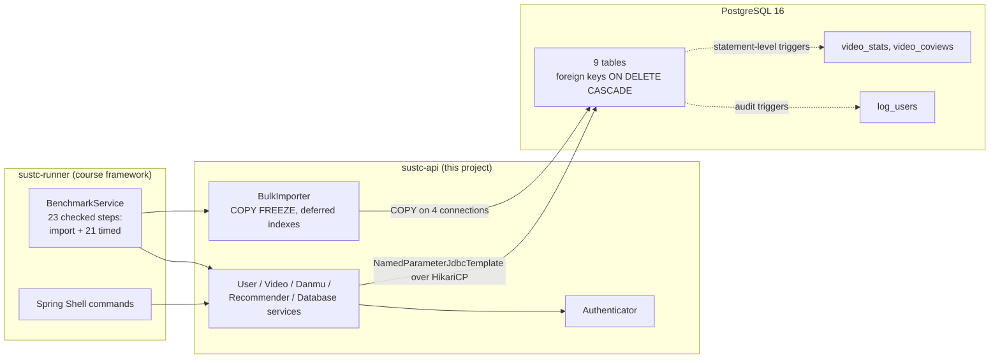

# Video-Sharing Platform Database System

**English** | [中文](README.zh-CN.md)

A PostgreSQL backend for a Bilibili-style video site: users, videos, danmu (time-synced
comments), likes / coins / favorites, follows, search and recommendations. Java 17, Spring Boot
2.7, hand-written SQL over JDBC (no ORM). It implements the service interfaces of our database
course framework, whose 23-step benchmark checks every answer and times the import and 21 of the
other 22 steps.

The 2023 course project is on the `main` branch, and it's the baseline for every number below.
On this branch (`optimize`) I went back to it in 2026 and reworked the schema, the queries and
the importer.

## Results

Both versions ran on the same machine and the same PostgreSQL 16 server, alternating, 3 runs
each, on one boot. All numbers are medians ([methodology](#methodology)).

- Passes **all 5,622** benchmark cases (the 2023 version passed 5,618).
- The 10 read and recommendation steps: **20.0 s → 1.09 s (18.3×)**. Similar videos and general
  recommendations got over 100× faster, personalized recommendations 32×, friend recommendations
  22×, search 4.6×.
- Data import (about 8.2 M rows): **103.4 s → 9.6 s (10.7×)**.
- All 21 timed steps together: **23.3 s → 4.9 s (4.8×)**.
- The 11 write steps got **14.5% slower** (3.29 s → 3.77 s). That's the cost of the triggers and
  foreign keys that make the reads fast; [the write path](#the-write-path) breaks it down.
- **Concurrency bugs fixed.** In a stress test with 8 threads, the 2023 version let users spend
  coins they didn't have in 45 of 45 trials; now it's 0 of 45. My own first rewrite lost like and
  follow toggles in 45 of 45 trials and deadlocked on crossing account deletions; both are now
  0 of 45.
- 150 tests (JUnit 5), 116 of them integration tests against PostgreSQL 16 in Testcontainers,
  passing on JDK 17 and 21. The CI workflow (`.github/workflows/ci.yml`) runs the same build on
  both JDKs.

Not everything got faster: by the medians, eleven steps are slower by 2-147 ms each, nine of the
eleven writes plus the two cheapest reads (hotspots 13 → 23 ms, danmu display 46 → 89 ms).

> The interfaces in `io.sustc.service`, the DTOs in `io.sustc.dto` and the whole `sustc-runner`
> module (shell and benchmark) come from the MIT-licensed course framework (see
> [LICENSE](LICENSE)); I didn't change the benchmark logic or data. My work is
> `sustc-api/src/main/java/io/sustc/service/impl/`, the SQL in `sql/`, the tests, the scripts and
> the docs.

More detail, one section per change with the important EXPLAIN plans:
[docs/ENGINEERING_NOTES.md](docs/ENGINEERING_NOTES.md).

## Architecture



- **Services** are Spring beans with constructor injection (`NamedParameterJdbcTemplate`,
  `Authenticator`, `Clock`). The `Clock` makes "now" testable; the benchmark pins it to the time
  its data was generated. [docs/DEVELOPMENT.md](docs/DEVELOPMENT.md#adding-a-rest-layer) says
  what a REST layer on top would need.
- **Every write is one atomic batch after authentication.** Coin donations, reviews, edits and
  cascading deletes are single statements (data-modifying CTEs, `ON CONFLICT`, foreign-key
  cascades). A toggle is an advisory lock on the user plus the toggle statement, sent in one
  round trip, so no explicit transaction is needed. If a call still loses a deadlock it is retried
  (up to 3 attempts).
- **Derived data lives in the database.** Per-video counters (`video_stats`) and co-viewing counts
  (`video_coviews`) are kept up to date by statement-level triggers, so recommendations read a
  few dozen rows instead of aggregating 2.2 M interaction rows on every call.
- **The importer** bulk-loads with `COPY`, rebuilds indexes and constraints afterwards, and if
  anything fails it leaves the imported tables empty with the full schema.

## Database design

Schema: [`sql/build.sql`](sql/build.sql). Audit log: [`sql/audit.sql`](sql/audit.sql). Example
roles: [`sql/usercontrol.sql`](sql/usercontrol.sql).


Each relation table is keyed by `(object, user)`, so "has user U liked video V?" is a primary-key
lookup. Foreign keys cascade on delete, so deleting a user or a video removes everything that
refers to it in the same statement (the 2023 code left danmu likes and some interactions
behind). Real values are `double precision`, and empty QQ / WeChat ids are stored as `NULL` so
the unique constraints only apply to users who have one.

Every index was added for a specific query (plans in [docs/explain](docs/explain)):

| Index | Used for |
|---|---|
| `followings (follower_mid, followee_mid)` PK | whom a user follows; mutual-follow check |
| `followings (followee_mid, follower_mid)` | followers of a user; friend recommendations use it as an index-only scan (the 2023 plan scanned all 6 M rows) |
| `viewers / videolikes / coins / favorites (bv, mid)` PK | "did U watch / like … V", per-video lists |
| `… (mid, bv)` on the same four tables | everything a user did (user info, account deletion, friends' views) as index-only scans |
| `videos (owner_mid, title)` unique | the spec's "no two videos with the same title per user" rule |
| `danmus (bv, time)` | danmu in a time range of a video, in order |
| `danmus (mid)`, `danmulikes (mid)`, `videos (reviewer)` | cascades when a user is deleted |
| `video_coviews (bv, other_bv)` PK, `(other_bv)` | similar videos: one index lookup, then a top-5 sort |

**Derived tables.** `video_stats` holds per-video counts and the sum of view times;
`video_coviews` holds, for every ordered pair of videos, how many users watched both.
Statement-level `AFTER` triggers with transition tables apply a whole statement's change as one
`INSERT … ON CONFLICT DO UPDATE`, in key order, so two firings of the same trigger lock shared
rows in the same order. The importer computes both tables in Java and loads them with `COPY`. A
test replays a random workload and compares both tables with a recomputation from scratch.

**Audit and roles.** `audit.sql` logs every insert, update and delete on `users` (with the role
and time, but without passwords, `qq` or `wechat`). It's a change log, not a tamper-proof audit
trail. `usercontrol.sql` is an optional example of three roles that the services and tests don't
use; it isn't safe as a real end-user setup (no row-level security).

## Performance

### Results

<!-- benchmark-table:start -->
| Step | Baseline ms (n=3) | Optimized ms (n=3) | Speedup | Passed (baseline → optimized) |
|---|---:|---:|---:|---:|
| 1 import | 103,387 [101,273–106,993] | 9,648 [9,335–9,816] | **10.7×** | – |
| 2 search | 313 [282–340] | 68 [56–72] | **4.6×** | 18 → 20 / 20 |
| 3 view rate | 55 [52–59] | 17 [16–19] | **3.2×** | 60 → 61 / 61 |
| 4 hotspot | 13 [12–20] | 23 [17–24] | 0.57× | 56 → 56 / 56 |
| 5 similar videos | 2,444 [2,249–3,036] | 18 [15–21] | **135.8×** | 43 → 43 / 43 |
| 6 general rec | 1,025 [1,023–1,621] | 6 [5–9] | **170.8×** | 11 → 11 / 11 |
| 7 user rec | 1,977 [1,949–2,474] | 62 [55–65] | **31.9×** | 27 → 27 / 27 |
| 8 friend rec | 13,694 [12,493–14,549] | 616 [609–661] | **22.2×** | 142 → 142 / 142 |
| 9 danmu display | 46 [43–54] | 89 | 0.52× | 382 → 382 / 382 |
| 10 danmu send | 228 [218–240] | 322 [299–387] | 0.71× | 1016 → 1016 / 1016 |
| 11 user info | 330 [276–365] | 183 [129–202] | **1.8×** | 500 → 500 / 500 |
| 12 danmu like | not timed | not timed | – | 500 → 500 / 500 |
| 13 coin | 636 [566–676] | 569 [560–724] | **1.1×** | 511 → 511 / 511 |
| 14 like | 636 [534–657] | 743 [742–1,006] | 0.86× | 686 → 686 / 686 |
| 15 collect | 569 [539–584] | 716 [618–741] | 0.79× | 644 → 644 / 644 |
| 16 post video | 58 [39–69] | 68 [58–71] | 0.85× | 184 → 184 / 184 |
| 17 register | 121 [90–124] | 112 [86–113] | **1.1×** | 273 → 273 / 273 |
| 18 update video | 22 [22–30] | 30 [22–32] | 0.73× | 184 → 184 / 184 |
| 19 review | 23 [19–23] | 26 [20–38] | 0.88× | 35 → 35 / 35 |
| 20 search after update | 136 [105–173] | 11 [9–14] | **12.4×** | 5 → 6 / 6 |
| 21 delete video | 492 [444–586] | 635 [569–666] | 0.77× | 55 → 55 / 55 |
| 22 delete account | 451 [427–478] | 490 [409–491] | 0.92× | 199 → 199 / 199 |
| 23 follow | 58 [51–59] | 60 [55–70] | 0.97× | 87 → 87 / 87 |
| **Read steps 2–9, 11, 20 (sum)** | **20,033** | **1,093** | **18.3×** | |
| **Write steps 10, 13–19, 21–23 (sum)** | **3,294** | **3,771** | 0.87× | |
| **All 21 timed steps (sum)** | **23,327** | **4,864** | **4.8×** | |
| **All test cases** | | | | **5618 → 5622 / 5622** |
<!-- benchmark-table:end -->

Generated by `python3 scripts/bench_table.py --write README.md README.zh-CN.md` from the raw
reports in [docs/benchmark/round3/plain](docs/benchmark/round3/plain) (`c6-B<i>.json` is the 2023
version, `c6-O<i>.json` this one, run in the order B1, O1, B2, O2, B3, O3). Times are the median
of 3 runs with the range in brackets. Step 12 isn't timed by the framework.

### What made the difference

| Change | Effect |
|---|---|
| Co-viewing counts kept in `video_coviews` | Similar videos: the 2023 code self-joined the 875 k-row `viewers` table on every call; now it reads the video's 43 co-viewing rows from an index and sorts them. Step 5: 2,444 → 18 ms. |
| Per-video counters kept in `video_stats` | General recommendations: the 2023 code aggregated all five interaction tables (2.2 M rows) on every call; now it joins two 44-row tables. Step 6: 1,025 → 6 ms. Personalized recommendations fall back to this for users without friends; step 7: 1,977 → 62 ms. |
| Covering index `followings (followee_mid, follower_mid)` and a rewritten friend query | Step 8: 13,694 → 616 ms. I checked that it isn't just missing statistics: with `VACUUM ANALYZE` right after the import, the 2023 code still took 11.4–12.2 s with the same plan. |
| Search counts occurrences with `replace()` and reads view counts from `video_stats` | Step 2: 313 → 68 ms. The 2023 code joined every view of every matching video and treated the keywords as regular expressions. |
| Bulk import with `COPY … FREEZE`, indexes and constraints built afterwards, foreign keys validated in parallel | Step 1: 103.4 s → 9.6 s (load 2.8 s, indexes 5.1 s, constraints 1.5 s, vacuum/analyze 0.2 s). |

The plans before and after are in [docs/explain](docs/explain) (`EXPLAIN (ANALYZE, BUFFERS)`,
regenerated by `scripts/explain_plans.sh`).

### The write path

The writes got slower, so I measured where the time goes instead of guessing
([engineering notes](docs/ENGINEERING_NOTES.md#the-write-path)):

- **It's not disk writeback.** When the write steps start, the kernel holds only 0.6–1.6 MB of
  dirty data in my runs.
- **The checkpoint after the import is about 5%.** With a `CHECKPOINT` and a pause after the
  import, the write steps took 3,189 ms vs 2,892 ms for the 2023 code.
- **Full-page images: +6.5%.** The foreign key from `danmus` into `users` locks each sender's
  row, and the first lock on a page after a checkpoint writes the whole page to the WAL
  ([fk-lock-wal.txt](docs/experiments/fk-lock-wal.txt)).
- **The rest is work per call.** pgbench puts the triggers of one like at about 0.13 ms and its
  foreign keys at 0.09 ms ([write-latency.txt](docs/experiments/write-latency.txt)).

To look at single operations I wrote WriteBench, which calls each write through the service
layer of either jar on the benchmark data, 600 calls per operation, 3 alternating runs per
version ([summary](docs/benchmark/round3/writebench/summary.md)). Median p50 in ms, 2023 code →
this version:

| Operation | 1 client | 8 clients | 8 clients, throughput this version / 2023 | Statements / round trips per call |
|---|---:|---:|---:|---:|
| coin | 1.40 → 1.03 | 2.47 → 2.47 | 0.96 | 7 / 7 → 2 / 2 |
| like video | 0.82 → 0.98 | 1.54 → 2.22 | 0.78 | 5 / 5 → 3 / 2 |
| collect | 0.87 → 0.93 | 1.78 → 2.20 | 0.85 | 5 / 5 → 3 / 2 |
| danmu send | 0.92 → 1.03 | 2.10 → 2.20 | 0.90 | 5.05 / 5.05 → 2 / 2 |
| danmu like | 0.81 → 0.74 | 1.49 → 2.01 | 0.79 | 5 / 5 → 3 / 2 |
| post video | 0.80 → 0.91 | 1.41 → 1.78 | 0.90 | 4 / 4 → 2 / 2 |
| register | 0.65 → 0.49 | 1.02 → 1.10 | 0.88 | 2 / 2 → 1 / 1 |
| update video | 0.64 → 0.93 | 1.28 → 1.48 | 0.94 | 4 / 4 → 2 / 2 |
| review | 0.53 → 0.62 | 1.02 → 1.00 | 1.16 | 3 / 3 → 2 / 2 |
| delete video, no views | 1.15 → 1.33 | 2.67 → 2.17 | 1.30 | 9 / 9 → 3 / 2 |
| delete video, ≈ 20,000 views | 26.14 → 53.52 | 133 → 297 | 0.38 | 9 / 9 → 3 / 2 |
| delete account | 5.93 → 6.92 | 29.35 → 108 | 0.29 | 13 / 13 → 3 / 2 |
| follow | 0.69 → 0.75 | 1.56 → 1.82 | 0.90 | 4 / 4 → 3 / 2 |

**Deletions** were the hardest part. My round-2 build lost 79–87 of 100 account deletions per
run on 8 clients to `deadlock detected`, caused by my own triggers: a deletion cascades table by
table, and each cascaded table's trigger locks the counters of its videos, so two deletions could
lock shared counters in crossing orders. Now a deletion takes an advisory "deletion lock" first
(only if the caller is allowed to delete), exclusive for an account and shared for a video. On
8 clients no deletion fails anymore (0 of 300 account deletions in round 4), but account
deletions run one at a time: 69.8 per second against 306.2 for the 2023 version (0.23×)
([round-4 summary](docs/benchmark/round4/writebench/summary.md)).

### Methodology

- **Rounds.** I worked in iterations, called rounds here: round 1 ended at `978fe40`, round 2 at
  `a330c0c`, round 3 at `ac3a0dc`, the code of the table above. Round 4 only re-ran WriteBench
  (deletions on 8 clients and stress mode) on the final code. Later commits changed the deletion
  locks, `derived_viewers`, `truncate()` and `usercontrol.sql`.
- **Machine.** One VM (4 vCPUs, 15 GiB RAM), one PostgreSQL 16 server with the same configuration
  for every run (`shared_buffers` 1 GB, `synchronous_commit` on, `full_page_writes` on,
  `max_wal_size` 1 GB, `checkpoint_timeout` 5 min).
- **Baseline.** The 2023 version is the service code of `2e811bd` on `main`, built from
  `3796695` (branch `bench/baseline-clock`), which only adds a clock offset. The two jars bundle
  different JDBC drivers (pgjdbc 42.3.8 vs 42.7.4); I didn't measure the driver's effect alone.
- **Clock.** Each run starts from a fresh schema and runs the unchanged framework benchmark with
  the service clock pinned to 2023-12-30 12:00 +08:00, when the bundled data was generated,
  because several cases compare public times with "now". The 2023 version's 4 failures come from
  its own code (three searches with repeated spaces in the keywords, one view rate off in the
  fourth digit because view times were summed as `real`).
- **Order.** 3 runs per version in the order B1, O1, B2, O2, B3, O3, all on one boot. Each run
  holds a lock file so other jobs on the machine never run during a run. No run was discarded.
- **Earlier rounds.** The round-1 runs in [docs/benchmark/round1](docs/benchmark/round1) ran the
  versions hours apart and aren't quoted anymore. The 2023 version also got slower from round to
  round (its import took 57.7 s in round 1 and 101.3–107.0 s in round 3), which is another reason
  the versions alternate now.
- The scripts are all in the repo: `scripts/run_bench.sh` runs one jar,
  `scripts/bench_instrumented.py` watches a run (WAL per step, dirty memory, checkpoints),
  `scripts/bench_series.sh` runs an interleaved series, and `scripts/compare.py` compares reports.
  [docs/DEVELOPMENT.md](docs/DEVELOPMENT.md#commands) has the commands.

## Correctness

The 2023 version failed 4 benchmark cases and had a few bugs the benchmark doesn't check. All of
them are fixed, each with a test:

- `follow` returns the state after the call; deleting an account removes the user's videos and
  everything on them, plus everything the user did; deleting a video also removes its danmu
  likes.
- Similar videos break ties by `bv`; search counts non-overlapping, case-insensitive occurrences
  (using ICU, so it also works for non-ASCII text on a C-locale database) and breaks ties by views,
  then `bv`.
- Unreviewed videos and videos before their public time are only visible to their owner and
  superusers.
- Coin donation is one statement, so the coin is only charged if the donation row is inserted
  (tested with 8 concurrent threads). Toggles, edits and co-view counts are safe under
  concurrency. `ConcurrencyTest` has 16 tests, and each fix's tests fail on the code before it
  ([concurrency-tests-old-vs-new.txt](docs/experiments/concurrency-tests-old-vs-new.txt),
  [deadlock-tests-old-vs-new.txt](docs/experiments/deadlock-tests-old-vs-new.txt),
  [round4-tests-old-vs-new.txt](docs/experiments/round4-tests-old-vs-new.txt)).
- Identity sequences continue after the imported ids, and no code path leaks a pooled connection
  (checked after every integration test).

Where the spec is ambiguous, my interpretations are listed in
[docs/ENGINEERING_NOTES.md](docs/ENGINEERING_NOTES.md#interpretations-of-the-specification).

## Running it

You need JDK 17 or 21 and Docker (for the tests and, optionally, the database).

```bash
# Build and run all tests (needs Docker: Testcontainers starts PostgreSQL 16)
./gradlew build

# A database for the runner (postgres:16-alpine on 127.0.0.1:5432; user, password and database are all "sustc").
# If port 5432 is taken: SUSTC_DB_PORT=55432 docker compose up -d, and PGPORT=55432 for the scripts.
cd sustc-runner && docker compose up -d && cd ..

# The course's test data (.ser files, not in this repository) goes to
#   sustc-runner/data/import/  and  sustc-runner/data/test/

# One benchmark run against a fresh schema; writes docs/benchmark/<label>.json
scripts/benchmark.sh --label my-run

# Rebuild the README table from docs/benchmark/round3/plain/c6-B*.json and c6-O*.json
python3 scripts/bench_table.py --write README.md README.zh-CN.md

# Micro-benchmarks and stress tests of the write operations (see scripts/writebench/run.sh)
scripts/writebench/run.sh --jar run/sustc-runner.jar --sql "sql/build.sql sql/audit.sql" \
    --out result.json -- --mode steady --clients 1 --ops 600 --warmup 300 --settle

# Interactive shell
./gradlew :sustc-runner:bootRun
```

## Limits and safety

- `scripts/benchmark.sh`, `scripts/explain_plans.sh`, `scripts/write_latency.sh` and
  `scripts/writebench/run.sh` **drop and recreate the `public` schema** of the target database.
  They only accept a loopback host unless you pass `--allow-remote`. Set `BENCH_LOCK` (or wrap the
  call in `flock`) to keep timing runs apart on a shared machine.
- WriteBench runs at most 16 client threads and 5,000 calls per operation. A few scripts run
  `CHECKPOINT` and `pg_waldump` through `sudo -u postgres`.
- Load on the database is bounded by the connection pool (HikariCP, 10 connections by default) and
  the importer's parallelism (4 connections by default). There's no other network traffic.

## Known limitations

- Passwords are stored in plain text, as in the provided data. The audit log no longer copies
  them, but logs written by older versions still contain them.
- Account deletions run one at a time (see [the write path](#the-write-path)). Letting them run
  concurrently again is still open
  ([open questions](docs/ENGINEERING_NOTES.md#open-questions)).
- The derived-table triggers need READ COMMITTED (PostgreSQL's default); `derived_viewers` refuses
  view changes under REPEATABLE READ, and SERIALIZABLE isn't tested.
- Single-row writes cost a bit more per call, up to 0.29 ms at 1 client, and deleting a video with
  about 20,000 views takes twice as long (26.14 → 53.52 ms).
- `video_coviews` holds up to N(N−1) rows for N videos. That's fine for this catalogue (all 1,892
  pairs of the 44 videos exist), but a large one would need unordered pairs or a cap per user.
- Danmu display is slower on its first calls in a fresh JVM, and the benchmark only times the
  first pass ([notes](docs/ENGINEERING_NOTES.md#hotspots-and-danmu-display)).
- Recommendations aren't filtered by visibility; the spec doesn't ask for it.
- Each service call authenticates with a separate query; folding that into the statement would
  save one round trip per call.
