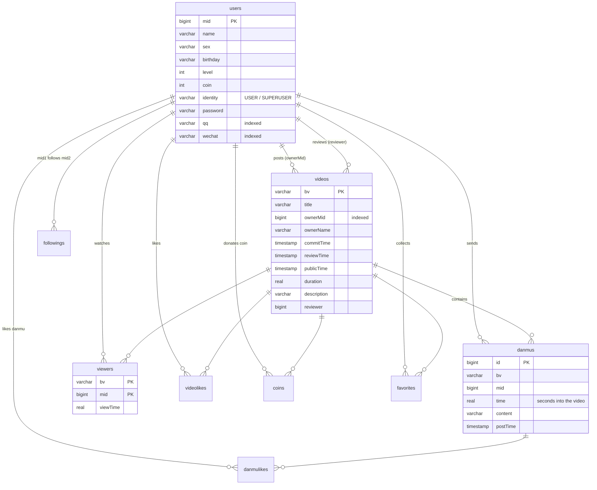

# Video-Sharing Platform Database System

**English** | [中文](README.zh-CN.md)

A database backend for a Bilibili-style video-sharing platform: users, videos, danmu (time-synced comments), likes / coins / favorites, follow relationships, and SQL-based search and recommendation.

- **Tech stack**: Java 17+ · Spring Boot 2.7 · plain JDBC (no ORM) · HikariCP · PostgreSQL 15/16 · Gradle
- **Size**: 5 service implementations, about 2,500 lines of Java; every core query is hand-written SQL
- **Result**: passed 5,618 of the 5,622 cases (99.9%) in the bundled 23-step benchmark

> The interfaces in `io.sustc.service.*`, the DTOs in `io.sustc.dto.*`, and the whole `sustc-runner` module (command-line shell and benchmark) come from an existing MIT-licensed project framework (see [LICENSE](LICENSE)).
> My work is everything under `sustc-api/src/main/java/io/sustc/service/impl/`, plus the schema, audit and permission scripts in `sql/`.

---

## Contents

- [Architecture](#architecture)
- [Database design](#database-design)
- [Features](#features)
- [Performance optimizations](#performance-optimizations)
- [Benchmark results](#benchmark-results)
- [Running it](#running-it)
- [Changes made in 2026](#changes-made-in-2026)
- [Known limitations](#known-limitations)

## Architecture

```
sustc-runner (provided framework)        sustc-api (my implementation)
┌──────────────────────────┐           ┌─────────────────────────────────┐
│ Spring Shell CLI          │  calls    │ UserServiceImpl                 │
│ BenchmarkService          │ ────────▶ │ VideoServiceImpl                │      JDBC
│ (loads test data and      │ interfaces│ DanmuServiceImpl                │ ───────────▶ PostgreSQL
│  checks the answers)      │           │ RecommenderServiceImpl          │
└──────────────────────────┘           │ DatabaseServiceImpl (import)    │
                                        │ AuthHelper (login & identity)   │
                                        └─────────────────────────────────┘
```

`sustc-api` is packaged as a jar and loaded by `sustc-runner`. The runner reaches the database through a `DataSource` (a HikariCP connection pool) injected by Spring, calls the interfaces concurrently, and compares each result with the expected answer.

## Database design

Schema script: [`sql/build.sql`](sql/build.sql)



Design notes:

- **3 entity tables**: `users`, `videos`, `danmus`.
- **6 relationship tables**: `followings`, `viewers`, `videolikes`, `coins`, `favorites`, `danmulikes`. The array fields in the raw data (like lists, following lists, and so on) are split into relationship tables keyed by `(user, object)`. This keeps the schema in 3NF, and checks such as "has this user already liked this video?" become a primary-key lookup.
- `viewers` also stores the watch time `viewTime`, which feeds the average view rate and the recommendation score.
- Each relationship table has a single-column index on each of its two columns, one for each lookup direction: "all likes of a video" and "all likes by a user".
- `users.qq` and `users.wechat` are indexed for third-party login (see [Performance optimizations](#performance-optimizations)).

Two more scripts:

- **Auditing**: [`sql/audit.sql`](sql/audit.sql) adds a row-level `AFTER INSERT/UPDATE/DELETE` trigger on `users`. It writes every change, with the database user and a timestamp, to `log_users`.
- **Permissions**: [`sql/usercontrol.sql`](sql/usercontrol.sql) creates three database roles with decreasing privileges. The super manager has full access. The manager can read and write every business table. A normal user can read, and can write only the interaction tables (danmu, likes, favorites, and so on).

## Features

| Area | API | Implementation notes |
|---|---|---|
| Data import | `importData` | Batched PreparedStatement inserts. The main thread and 4 worker threads load different tables in parallel, each on its own connection |
| Users | `register` `deleteAccount` `follow` `getUserInfo` | Login by mid + password, QQ, or WeChat. Regular users can only delete themselves; superusers can also delete regular users. Deleting an account cascades to all of the user's interaction records |
| Videos | `postVideo` `updateVideoInfo` `deleteVideo` `reviewVideo` | Editing a reviewed video sends it back for review. Only superusers can review, and never their own videos |
| Interactions | `likeVideo` `coinVideo` `collectVideo` | Allowed only on videos the user can find in search. A coin costs one of the user's coins and can't be taken back. Liking or collecting a second time undoes it |
| Search | `searchVideo` | A single SQL query counts how many times each keyword appears in the title, description and uploader name (`regexp_split_to_array`), sorts by relevance and then view count, and paginates inside the database |
| Statistics | `getAverageViewRate` `getHotspot` | Hotspot: split the video into 10-second chunks; the chunks with the most danmu are the hotspots |
| Danmu | `sendDanmu` `displayDanmu` `likeDanmu` | A user must have watched the video before sending danmu. Danmu are shown for a time range, optionally with duplicate content removed |
| Recommendation | `recommendNextVideo` | Similarity = number of users who watched both videos (self-join on `viewers`) |
| | `generalRecommendations` | Popularity = like rate + coin rate + favorite rate + danmu per viewer + completion rate, each aggregated in its own subquery and then joined |
| | `recommendVideosForUser` | Friends = mutual follows (self-join on `followings`). Recommends videos that friends watched and the user hasn't; falls back to general recommendations when there are none |
| | `recommendFriends` | Recommends users the user doesn't follow yet, ranked by number of shared followings |

## Performance optimizations

These numbers were measured on my machine in 2023.

| Optimization | Approach | Effect |
|---|---|---|
| Batch inserts | One prepared statement per table, sent in one go with `addBatch` / `executeBatch` instead of one SQL statement per row | Import time down about **30%** (two runs: 176.6 s → 121.8 s and 494.4 s → 346.7 s) |
| Parallel import | The 9 tables have no foreign-key dependencies, so they are split into 5 groups loaded in parallel on 5 connections | A further **38%** on top of batching (121.8 s → 75.4 s) |
| Login indexes | Third-party login looks users up by `qq` and `wechat`, so both columns are indexed | Total time for 1,016 login lookups went from 602 ms to 38 ms, about **16×** |
| Computing in the database | Search relevance, recommendation scores, sorting and pagination all happen in SQL; only the bv IDs of the requested page come back to Java | Avoids moving large result sets into the application |

## Benchmark results

The benchmark has 23 steps. Step 1 imports about 38,000 users plus hundreds of thousands of watch and interaction records (the test data is not included in this repo). The other 22 steps call the APIs concurrently and compare each result with the expected answer.

| # | Test | Passed / total | Time (ms) | Reference time (ms) |
|---|---|---|---|---|
| 1 | Import data | — | 76,115 | 281,878 |
| 2 | Video search | 18 / 20 | 792 | 219 |
| 3 | Average view rate | 60 / 61 | 76 | 47 |
| 4 | Hotspot chunks | 56 / 56 | 11 | 10 |
| 5 | Similar-video recommendation | 43 / 43 | 4,687 | 1,815 |
| 6 | General recommendation | 11 / 11 | 1,467 | 944 |
| 7 | Personalized recommendation | 27 / 27 | 2,770 | 2,844 |
| 8 | Friend recommendation | 142 / 142 | 15,650 | 7,900 |
| 9 | Display danmu | 382 / 382 | 25 | 18 |
| 10 | Send danmu | 1016 / 1016 | 94 | 44 |
| 11 | User info | 500 / 500 | 364 | 247 |
| 12 | Like danmu | 500 / 500 | — | — |
| 13 | Coin | 511 / 511 | 553 | 163 |
| 14 | Like | 686 / 686 | 577 | 193 |
| 15 | Collect | 644 / 644 | 506 | 169 |
| 16 | Post video | 184 / 184 | 40 | 39 |
| 17 | Register | 273 / 273 | 50 | 42 |
| 18 | Update video info | 184 / 184 | 52 | 44 |
| 19 | Review video | 35 / 35 | 19 | 12 |
| 20 | Search after update and review | 5 / 6 | 292 | 54 |
| 21 | Delete video | 55 / 55 | 400 | 376 |
| 22 | Delete account | 199 / 199 | 301 | 147 |
| 23 | Follow | 87 / 87 | 45 | 27 |

- The "Passed / total" and "Time" columns are from the 2023 version. Raw file: [`docs/benchmark/original-result.json`](docs/benchmark/original-result.json).
- The reference numbers come with the framework: [`docs/benchmark/reference-standard.json`](docs/benchmark/reference-standard.json). They were not measured on the same machine, so compare times only roughly.
- The framework does not record a time for step 12.

### 2026 re-run

After cleaning up the repo, I ran the original 2023 code and the fixed code on the same machine (PostgreSQL 15, JDK 21):

| | Original code | Fixed code |
|---|---|---|
| Total passed | 5516 | 5516 |
| Passed per step | — | identical to the original code |

Both pass 102 fewer cases than in 2023. All of them are in steps #16 post, #18 update, #19 review and #21 delete. The cause is that the test data sets the videos' public time to `2025-11-30`. The spec says the public time must not be earlier than the current time, and that date has now passed, so these videos are rejected when posted, and reviewing or deleting them then fails as well. This has nothing to do with the code: runs before November 2025 are not affected.

## Running it

You need JDK 17 or 21 and Docker (or a PostgreSQL 15+ you installed yourself).

```bash
# 1. Start the database (user, password and database are all "sustc", matching application.yml)
cd sustc-runner && docker compose up -d && cd ..

# 2. Create the tables
psql -h localhost -U sustc -d sustc -f sql/build.sql

# 3. Put the test data (.ser files, not included in this repo) in sustc-runner/data/import/ and sustc-runner/data/test/

# 4. Run the benchmark; results go to sustc-runner/benchmark-<id>-<timestamp>.json
./gradlew :sustc-runner:benchmark

# Or start the interactive shell and call the APIs by hand
./gradlew :sustc-runner:bootRun
```

> If the project path contains non-ASCII characters, the Lombok plugin may fail with `MalformedInputException`. Add
> `"-Dorg.gradle.jvmargs=-Dfile.encoding=UTF-8 -Dsun.jnu.encoding=UTF-8"`, or move the project to an ASCII-only path.

To package `sustc-api` as a standalone jar: `./gradlew :sustc-api:submitJar`. The output is `submit/sustc-api.jar`.

## Changes made in 2026

While cleaning up the repo in 2026, I checked the code against the interface docs again and fixed three spec violations that the benchmark did not catch:

1. **Login by mid didn't check the password**: any existing mid was accepted. A request whose qq and wechat belong to different users wasn't rejected either. Login now lives in one place, [`AuthHelper`](sustc-api/src/main/java/io/sustc/service/impl/AuthHelper.java), and follows the interface docs exactly.
2. **`updateVideoInfo` changed every video the user owned**: the UPDATE was filtered by `where ownerMid = ?` instead of `where bv = ?`. Fixed, and the check that the new title doesn't clash with another of the user's videos was added.
3. **Regular users could review videos**: now only superusers can. The checks are also part of the UPDATE statement itself, so when two superusers review the same video at the same time, only one succeeds.

Other cleanup:

- Each of the 4 service classes had an identical copy of the login, identity-lookup and empty-check code. They now share `AuthHelper`, which removes about 330 lines of duplicated code. The old empty check `s == ""` compared references and so never worked; it is now `isEmpty()`.
- Fixed the bundled SQL scripts: `usercontrol.sql` referred to a table that doesn't exist, and the last line of `audit.sql` dropped the trigger it had just created.
- Removed build outputs, test data, scratch SQL and a JVM crash log, and fixed `.gitignore` (the old rules also ignored the Gradle wrapper).

## Known limitations

These were not changed this time:

- **No transactions**: deleting an account or a video runs several DELETE statements, so a failure halfway leaves partial data. Donating a coin is a read followed by a write, so under heavy concurrency a coin could be spent twice. These should run in a transaction or use a conditional UPDATE.
- **Connections aren't always managed with try-with-resources**: most methods leak their database connection when an exception is thrown.
- **Search**: unreviewed videos aren't filtered out, and only some regex special characters in keywords are escaped. These are probably why steps 2 and 20 don't fully pass (not verified case by case).
- **Recommendation**: similar-video recommendation lacks the tie-break "then by bv ascending", and in general recommendation the danmu-per-viewer term shouldn't be capped at 1.
- **Schema**: no foreign keys or NOT NULL constraints, so cascading deletes depend entirely on application code. `danmus.bv` has no index. New user mids and danmu ids are random numbers; they should come from a sequence.
- **Security**: passwords are stored in plain text (the test data itself stores them in plain text).
- **Import**: the main thread polls a plain array to find out whether the import threads are done. It should use `Thread.join()` or an `ExecutorService`; as it is, if any thread throws, the main thread waits forever.
