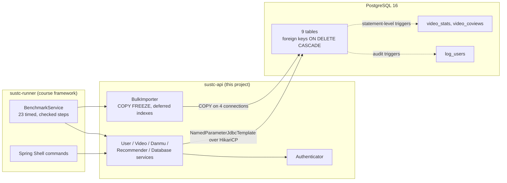

# Video-Sharing Platform Database System

**English** | [中文](README.zh-CN.md)

A PostgreSQL backend for a Bilibili-style video-sharing platform: users, videos, danmu (time-synced comments), likes / coins / favorites, follow relations, search and recommendations. Java 17, Spring Boot 2.7, hand-written SQL over JDBC (no ORM). It implements the service interfaces of a course framework, whose 23-step benchmark checks every answer and times every step.

**Results** (same machine and PostgreSQL 16 configuration, 3 runs each, medians; [methodology](#methodology)):

- Passes **all 5,622** benchmark cases; the original implementation passed 5,618.
- Data import (≈ 8.2 M rows): **57.7 s → 8.3 s (7.0×)**.
- The 22 query and update steps together: **15.2 s → 3.9 s (3.9×)**. Similar videos 72×, general recommendations 119×, personalized recommendations 28×, friend recommendations 16×, search 5×.
- A whole benchmark run, JVM start included: 80 s → 20 s.
- 103 tests (JUnit 5, Testcontainers with PostgreSQL 16), CI on JDK 17 and 21.

The price is paid on small steps: 13 of them are slower than before, by 11–309 ms each. Eleven are single-row writes and deletes, which now check foreign keys, maintain precomputed counters and run right after a much faster import; [the write path](#the-write-path) measures where that time goes. The other two are cheap reads (hotspots, danmu display) whose queries take well under 1 ms in the database.

> The interfaces in `io.sustc.service`, the DTOs in `io.sustc.dto` and the whole `sustc-runner` module (shell and benchmark) come from an MIT-licensed course framework (see [LICENSE](LICENSE)); the benchmark logic and data are unchanged. This project's work is `sustc-api/src/main/java/io/sustc/service/impl/`, the SQL in `sql/`, the tests, the scripts and the documentation.

## Contents

- [Architecture](#architecture)
- [Database design](#database-design)
- [Performance](#performance)
- [Correctness](#correctness)
- [Running it](#running-it)
- [Limits and safety](#limits-and-safety)
- [Known limitations](#known-limitations)

Deeper notes, one section per change with the key EXPLAIN plans: [docs/ENGINEERING_NOTES.md](docs/ENGINEERING_NOTES.md).

## Architecture



- **Services** are Spring beans with constructor injection (`NamedParameterJdbcTemplate`, `Authenticator`, `Clock`), so a REST layer can reuse them as they are. The `Clock` makes "now" testable; the benchmark pins it to the time its data was generated.
- **Every write is one SQL statement.** Toggles, coin donations, reviews and cascading deletes are single statements (data-modifying CTEs, `ON CONFLICT`, foreign-key cascades), so each one is atomic and race-free without an explicit transaction, and costs one round trip.
- **Derived data lives in the database.** Per-video counters (`video_stats`) and co-viewing counts (`video_coviews`) are kept up to date by statement-level triggers, so recommendations read a few dozen rows instead of aggregating 2.2 M interaction rows per call.
- **The importer** bulk-loads with `COPY`, rebuilds indexes and constraints afterwards from the catalog, and leaves an empty database with the complete schema if anything fails.

## Database design

Schema: [`sql/build.sql`](sql/build.sql). Audit log: [`sql/audit.sql`](sql/audit.sql). Roles and privileges: [`sql/usercontrol.sql`](sql/usercontrol.sql).


**Conventions.** Each relation table is keyed by `(object, user)`, so "has user U liked video V?" is a primary-key probe. Foreign keys cascade on delete, so deleting a user or a video removes everything that refers to it in the same statement (the original code left danmu likes and some interactions behind). Real values are `double precision`, so sums are not accumulated in `float4`. Ids come from identity columns, which the importer moves past the imported ids. Empty QQ / WeChat ids are stored as `NULL`, so the unique constraints only apply to users who have one.

**Indexes and what they are for.** Every index below was chosen for a specific query; the plans are in [docs/explain](docs/explain).

| Index | Serves |
|---|---|
| `followings (follower_mid, followee_mid)` PK | whom a user follows; mutual-follow check |
| `followings (followee_mid, follower_mid)` | followers of a user; friend recommendations probe it once per followee as an index-only scan (the original plan scanned all 6 M rows) |
| `viewers / videolikes / coins / favorites (bv, mid)` PK | "did U watch / like … V", per-video lists |
| `… (mid, bv)` on the same four tables | everything a user did (user info, account deletion cascades, friends' views) as index-only scans |
| `videos (owner_mid, title)` unique | the spec's "same title for the same user" rule; also the owner's videos |
| `danmus (bv, time)` | danmu in a time range of a video, in order |
| `danmus (mid)`, `danmulikes (mid)`, `videos (reviewer)` | cascades when a user is deleted |
| `video_coviews (bv, other_bv)` PK, `(other_bv)` | similar videos: one index lookup of the video's co-viewing rows, then a top-5 sort; cascades |

**Derived tables.** `video_stats` holds per-video counts and the sum of view times; `video_coviews` holds, for every ordered pair of videos, the number of users who watched both. Statement-level `AFTER` triggers with transition tables apply the change of a whole statement as one `INSERT … ON CONFLICT DO UPDATE` (or one `DELETE`/`UPDATE` for co-views), in key order, so concurrent statements take the row locks in the same order. The importer computes both tables in Java from the records and loads them with `COPY` like the other tables. A test replays a seeded random workload of service calls and multi-row SQL and compares both tables with a recomputation from scratch.

**Audit and roles.** `audit.sql` records every insert, update and delete on `users` (with the database role and time) through statement-level triggers. `usercontrol.sql` creates three roles with decreasing privileges, including what the derived-table triggers need, since triggers run with the invoking role's privileges.

## Performance

### Results

<!-- benchmark-table:start -->
| Step | Baseline ms (n=3) | Optimized ms (n=3) | Speedup | Passed (baseline → optimized) |
|---|---:|---:|---:|---:|
| 1 import | 57,674 [56,775–58,559] | 8,259 [8,095–8,424] | **7.0×** | – |
| 2 search | 197 [184–331] | 39 [37–50] | **5.1×** | 18 → 20 / 20 |
| 3 view rate | 39 [38–49] | 17 [17–26] | **2.3×** | 60 → 61 / 61 |
| 4 hotspot | 10 [9–14] | 27 [24–28] | 0.37× | 56 → 56 / 56 |
| 5 similar videos | 1,736 [1,624–1,814] | 24 [23–28] | **72.3×** | 43 → 43 / 43 |
| 6 general rec | 831 [762–854] | 7 [4–8] | **118.7×** | 11 → 11 / 11 |
| 7 user rec | 1,580 [1,460–1,630] | 56 [55–66] | **28.2×** | 27 → 27 / 27 |
| 8 friend rec | 8,910 [1,932–9,008] | 549 [523–628] | **16.2×** | 142 → 142 / 142 |
| 9 danmu display | 34 [25–37] | 77 [67–104] | 0.44× | 382 → 382 / 382 |
| 10 danmu send | 120 [106–127] | 313 [303–585] | 0.38× | 1016 → 1016 / 1016 |
| 11 user info | 202 [171–213] | 155 [141–159] | **1.3×** | 500 → 500 / 500 |
| 12 danmu like | not timed | not timed | – | 500 → 500 / 500 |
| 13 coin | 309 [302–364] | 444 [374–1,090] | 0.70× | 511 → 511 / 511 |
| 14 like | 266 [261–306] | 575 [571–837] | 0.46× | 686 → 686 / 686 |
| 15 collect | 255 [240–276] | 518 [441–531] | 0.49× | 644 → 644 / 644 |
| 16 post video | 22 [21–28] | 73 [70–94] | 0.30× | 184 → 184 / 184 |
| 17 register | 57 [53–67] | 110 [89–110] | 0.52× | 273 → 273 / 273 |
| 18 update video | 19 [12–23] | 30 [22–32] | 0.63× | 184 → 184 / 184 |
| 19 review | 12 [11–12] | 26 [22–31] | 0.46× | 35 → 35 / 35 |
| 20 search after update | 85 [79–145] | 7 [6–10] | **12.1×** | 5 → 6 / 6 |
| 21 delete video | 287 [279–290] | 529 [525–555] | 0.54× | 55 → 55 / 55 |
| 22 delete account | 205 [200–350] | 303 [278–309] | 0.68× | 199 → 199 / 199 |
| 23 follow | 20 [20–27] | 44 [43–47] | 0.45× | 87 → 87 / 87 |
| **Sum of query steps 2–23** | **15,196** | **3,923** | **3.9×** | |
| **All test cases** | | | | **5618 → 5622 / 5622** |
<!-- benchmark-table:end -->

Generated by `python3 scripts/bench_table.py --write README.md README.zh-CN.md` from the raw reports in [docs/benchmark](docs/benchmark) (`baseline-*.json`: the original implementation; `optimized-*.json`: this version). Times are the median of 3 runs with the range in brackets; speedups divide the two medians. Step 12 is not timed by the framework. The older `original-result.json` and `reference-standard.json` there are from 2023 and another machine and are not used.

### What made the difference

Per-query times are from `EXPLAIN (ANALYZE, BUFFERS)` on the same data ([docs/explain](docs/explain), regenerated by `scripts/explain_plans.sh`). Its per-node timing adds to every row a plan produces: on a 638 k-row join and aggregation here it reported 200–205 ms, against 129–133 ms with `TIMING OFF` and 122–124 ms run plainly (three runs each) ([docs/experiments/explain-overhead.txt](docs/experiments/explain-overhead.txt)). So the row-heavy original plans below are slower in these listings than they run, and the ratios between single queries overstate the gain; the end-to-end figures are in the table above.

| Change | Effect |
|---|---|
| Co-viewing counts kept in `video_coviews` | similar videos: a self-join of the 875 k-row `viewers` table (164.5 ms) becomes an index lookup of that video's 43 co-viewing rows plus a top-5 sort (0.06 ms) |
| Per-video counters kept in `video_stats` | general recommendations: a hash aggregate over each of the five interaction tables, 2.2 M rows in all (725 ms), becomes a join of two 44-row tables (0.09 ms); users without friends fall back to it, so personalized recommendations gain too |
| Covering index `followings (followee_mid, follower_mid)` and a rewritten friend query | friend recommendations, median case: 331 ms → 11 ms; largest case (1,762 followings): 441 ms → 122 ms. Without statistics the original plan took 608 ms / 663 ms, and the original importer never ran `ANALYZE` (its three runs took 1.9 s, 8.9 s and 9.0 s for this step) |
| Search counts non-overlapping occurrences with `replace()` and reads view counts from `video_stats` | 13.9 ms → 0.37 ms for a two-keyword search; the original joined every view of every matching video, and used the keywords as regular expressions |
| Bulk import with `COPY … FREEZE`, indexes and constraints built afterwards, foreign keys validated in parallel, `VACUUM (ANALYZE)` at the end | 57.7 s → 8.3 s; phases (median): load 2.3 s, indexes 4.3 s, constraints 1.1 s, vacuum/analyze 0.2 s |

### The write path

Single-row writes (coin, like, collect, post, register, update, follow, review, danmu send) and the two deletes are slower than before, by 11–309 ms per step. Measured with pgbench, one client, 1,000 transactions per line ([docs/experiments/write-latency.txt](docs/experiments/write-latency.txt), `scripts/write_latency.sh`):

| likeVideo (authentication + toggle) | latency |
|---|---|
| right after a fresh import (≈ 140 MiB of dirty pages still to write back) | 1.30 ms |
| 120 s later | 0.78 ms |
| without the derived-table triggers | 0.69 ms |
| … and without the foreign keys | 0.80 ms (no measurable cost) |
| original 5-statement sequence vs. current, alternating rounds | 0.94–1.24 ms vs. 0.81–0.90 ms |

So, at steady state a write is not slower than the original one: the triggers add about 0.1–0.2 ms and the foreign keys nothing measurable. The benchmark, however, runs its write steps seconds after an import that now finishes in 8 s instead of 58 s, while the import's data is still being written back and a checkpoint is in progress (every first change of a page after a checkpoint starts writes a full-page image to the WAL). The deletes are also doing more work than before: the original schema has no foreign keys, and its deletes left behind the danmu likes of a deleted video and, for a deleted user, everything other users had done on that user's videos and danmus.

### Methodology

- One machine (4 vCPUs, 16 GB RAM), one PostgreSQL 16 server with the same configuration for all runs (`shared_buffers` 1 GB, `synchronous_commit` on, `max_wal_size` 1 GB, JIT on). The baseline is the original implementation (commit `2e811bd`, built by the harness with the clock offset described below) with its own schema.
- Each run starts from a freshly created schema (for this version `sql/build.sql` + `sql/audit.sql`) and runs the unchanged framework benchmark with the service clock pinned to 2023-12-30 12:00 +08:00 (`-Dsustc.clock.start=…`, JVM time zone Asia/Shanghai), when the bundled data was generated: several cases compare public times with "now". The original implementation reads `Instant.now()`; the harness's build of it adds a constant offset to reach the same start time. Its 4 failures come from its code: three searches whose keywords contain repeated spaces, and one view rate that is off in the fourth digit because view times are summed as `real`.
- 3 runs per version, one after another, each holding an exclusive lock so that no other benchmark on the machine overlapped it; both groups were preceded by at least one run that is not counted. Reported: median per step, range in brackets; pass counts are the minimum over the runs.
- The recorded runs used a harness script outside this repository; `scripts/benchmark.sh --label NAME` performs the same steps with the same JVM flags (localhost only by default, see below).

## Correctness

The original implementation failed 4 benchmark cases and had several problems the benchmark does not check. This version fixes them, each covered by a test:

- `follow` returns the state after the call; deleting an account removes the user's videos and everything on them, as well as everything the user did; deleting a video also removes its danmu likes.
- Similar videos break ties by `bv`; search relevance counts non-overlapping, case-insensitive occurrences (the Javadoc examples are tests) and breaks ties by views, then `bv`.
- Unreviewed videos and videos before their public time are visible only to their owner and superusers, in search and for every interaction.
- Coin donation is one statement: the coin is charged only if the donation row is inserted (tested with 8 concurrent threads); every other multi-step write is a single statement too.
- Identity sequences continue after the imported ids; no code path leaks a pooled connection (checked after every integration test).

Interpretations of the specification where it is ambiguous are listed in [docs/ENGINEERING_NOTES.md](docs/ENGINEERING_NOTES.md#interpretations-of-the-specification).

## Running it

Requirements: JDK 17 or 21, Docker (for the tests and, optionally, the database).

```bash
# Build and run all tests (needs Docker: Testcontainers starts PostgreSQL 16)
./gradlew build

# A database for the runner: user, password and database are all "sustc"
cd sustc-runner && docker compose up -d && cd ..

# The course's test data (.ser files, not in this repository) goes to
#   sustc-runner/data/import/  and  sustc-runner/data/test/

# One benchmark run against a fresh schema; writes docs/benchmark/<label>.json
scripts/benchmark.sh --label my-run

# Rebuild the README table from docs/benchmark/baseline-*.json and optimized-*.json
python3 scripts/bench_table.py --write README.md README.zh-CN.md

# Interactive shell
./gradlew :sustc-runner:bootRun
```

## Limits and safety

- `scripts/benchmark.sh`, `scripts/explain_plans.sh` and `scripts/write_latency.sh` **drop and recreate the `public` schema** of the target database. They accept only a loopback host (`localhost`, `127.*`, `::1`) unless `--allow-remote` is passed. Set `BENCH_LOCK=/path/to/lockfile` to serialize timing runs on a shared machine.
- Load on the database is bounded by the connection pool (HikariCP, default 10 connections; `spring.datasource.hikari.maximum-pool-size`) and by the importer's parallelism (`sustc.import.parallelism`, default 4 connections, at most one `COPY` stream each). There is no other network traffic and no bandwidth throttling.
- The benchmark itself runs some steps on a parallel stream; that is part of the unchanged framework.

## Known limitations

- Passwords are stored in plain text, as in the provided data.
- Writes are slower right after a bulk import (see [the write path](#the-write-path)); a production setup would schedule a checkpoint after the import, which needs a privileged role.
- Recommendations are not filtered by visibility; the specification does not ask for it.
- `TRUNCATE` bypasses the derived-table triggers; `DatabaseService.truncate()` empties the derived tables together with everything else.
- Each service call authenticates with a separate query before its statement; folding authentication into the statement would save one round trip per call.
