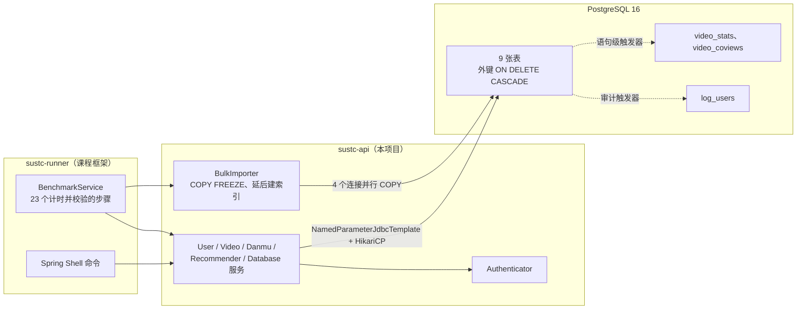

# 视频分享平台数据库系统

[English](README.md) | **中文**

一个仿 Bilibili 的视频分享平台的 PostgreSQL 后端：用户、视频、弹幕、点赞 / 投币 / 收藏、关注关系、搜索与推荐。Java 17、Spring Boot 2.7，基于 JDBC 手写 SQL（不使用 ORM）。项目实现了一个课程框架的服务接口，框架自带的 23 步基准测试会校验每个结果并为每一步计时。

**结果**（同一台机器、同一份 PostgreSQL 16 配置，每个版本 3 次运行取中位数；见[测试方法](#测试方法)）：

- 通过全部 **5,622** 个测试用例；原实现通过 5,618 个。
- 数据导入（约 820 万行）：**57.7 s → 8.3 s（7.0×）**。
- 22 个查询和更新步骤合计：**15.2 s → 3.9 s（3.9×）**。其中相似视频 72×、通用推荐 119×、个性化推荐 28×、好友推荐 16×、搜索 5×。
- 一次完整的基准测试（含 JVM 启动）：80 s → 20 s。
- 103 个测试（JUnit 5、Testcontainers + PostgreSQL 16），CI 覆盖 JDK 17 和 21。

代价落在小步骤上：有 13 个步骤比原来慢，每步慢 11–309 ms。其中 11 个是单行写入和删除，它们现在要检查外键、维护预计算的计数，而且紧跟在快得多的导入之后运行；[写入路径](#写入路径)一节测量了这些时间花在哪里。另外两个是开销很小的读操作（热点、弹幕展示），它们的查询在数据库里都远低于 1 ms。

> `io.sustc.service` 中的接口、`io.sustc.dto` 中的 DTO 以及整个 `sustc-runner` 模块（命令行和基准测试）来自一个 MIT 许可的课程框架（见 [LICENSE](LICENSE)），基准测试的逻辑和数据都没有改动。本项目的工作是 `sustc-api/src/main/java/io/sustc/service/impl/`、`sql/` 下的 SQL、测试、脚本和文档。

## 目录

- [架构](#架构)
- [数据库设计](#数据库设计)
- [性能](#性能)
- [正确性](#正确性)
- [运行](#运行)
- [限制与安全](#限制与安全)
- [已知局限](#已知局限)

更详细的说明（每项改动一节，附关键的 EXPLAIN 计划）：[docs/ENGINEERING_NOTES.md](docs/ENGINEERING_NOTES.md)（英文）。

## 架构



- **服务**都是通过构造器注入依赖（`NamedParameterJdbcTemplate`、`Authenticator`、`Clock`）的 Spring Bean，以后加 REST 层可以直接复用。`Clock` 让"当前时间"可测试；基准测试把它固定在测试数据生成的时刻。
- **每次写入都是一条 SQL 语句。** 切换点赞/收藏、投币、审核以及级联删除都是单条语句（带数据修改的 CTE、`ON CONFLICT`、外键级联），因此不需要显式事务就是原子的、没有竞态，而且只需一次往返。
- **派生数据保存在数据库里。** 每个视频的计数（`video_stats`）和共同观看次数（`video_coviews`）由语句级触发器实时维护，推荐查询只需读几十行，而不必每次聚合 220 万行互动记录。
- **导入器**用 `COPY` 批量加载，之后再根据系统目录重建索引和约束；任何一步失败都会留下一个结构完整的空数据库。

## 数据库设计

表结构：[`sql/build.sql`](sql/build.sql)。审计日志：[`sql/audit.sql`](sql/audit.sql)。角色与权限：[`sql/usercontrol.sql`](sql/usercontrol.sql)。


**约定。** 每张关系表的主键都是 `(对象, 用户)`，所以"用户 U 是否赞过视频 V"就是一次主键查找。外键都设置了级联删除，删除用户或视频时，所有引用它的数据在同一条语句里一并删除（原代码会遗留弹幕点赞和部分互动记录）。实数一律用 `double precision`，求和不会在 `float4` 中累积误差。ID 来自 identity 列，导入器会把序列移到已导入的最大 ID 之后。空的 QQ / 微信号存为 `NULL`，唯一约束只作用于真正有这些账号的用户。

**索引及其用途。** 下面每个索引都对应具体的查询；执行计划见 [docs/explain](docs/explain)。

| 索引 | 服务于 |
|---|---|
| `followings (follower_mid, followee_mid)` 主键 | 用户关注了谁；互关判断 |
| `followings (followee_mid, follower_mid)` | 用户的粉丝；好友推荐对每个被关注者做一次仅索引扫描（原计划要扫描全部 600 万行） |
| `viewers / videolikes / coins / favorites (bv, mid)` 主键 | "U 是否看过 / 赞过……V"，以及每个视频的列表 |
| 同样四张表上的 `(mid, bv)` | 用户做过的所有事情（用户信息、删除账号时的级联、好友看过的视频），均为仅索引扫描 |
| `videos (owner_mid, title)` 唯一 | 规范中"同一用户不能有同名视频"；也用于查询某用户的视频 |
| `danmus (bv, time)` | 按时间顺序取某视频一段时间内的弹幕 |
| `danmus (mid)`、`danmulikes (mid)`、`videos (reviewer)` | 删除用户时的级联 |
| `video_coviews (bv, other_bv)` 主键、`(other_bv)` | 相似视频：按索引取出该视频的共同观看行，再取前 5 个；级联删除 |

**派生表。** `video_stats` 保存每个视频的各项计数和观看时长之和；`video_coviews` 对每一对有序的视频保存同时看过两者的用户数。带转换表（transition table）的语句级 `AFTER` 触发器把一条语句造成的全部变化合并成一条 `INSERT … ON CONFLICT DO UPDATE`（共同观看则是一条 `DELETE`/`UPDATE`），并按主键顺序执行，因此并发语句以相同的顺序加行锁。导入器在 Java 中根据导入记录算出这两张表，并像其他表一样用 `COPY` 加载。有一个测试用带固定种子的随机负载（服务调用加多行 SQL）驱动这两张表，再与从头重新计算的结果逐行比较。

**审计与角色。** `audit.sql` 通过语句级触发器记录 `users` 上的每次插入、更新和删除（包括数据库角色和时间）。`usercontrol.sql` 创建三个权限递减的角色，并包含派生表触发器所需的权限，因为触发器以调用者的权限运行。

## 性能

### 结果

<!-- benchmark-table:start -->
| 步骤 | 基线 ms (n=3) | 优化后 ms (n=3) | 加速比 | 通过数（基线 → 优化后） |
|---|---:|---:|---:|---:|
| 1 数据导入 | 57,674 [56,775–58,559] | 8,259 [8,095–8,424] | **7.0×** | – |
| 2 搜索视频 | 197 [184–331] | 39 [37–50] | **5.1×** | 18 → 20 / 20 |
| 3 平均观看率 | 39 [38–49] | 17 [17–26] | **2.3×** | 60 → 61 / 61 |
| 4 弹幕热点 | 10 [9–14] | 27 [24–28] | 0.37× | 56 → 56 / 56 |
| 5 相似视频 | 1,736 [1,624–1,814] | 24 [23–28] | **72.3×** | 43 → 43 / 43 |
| 6 通用推荐 | 831 [762–854] | 7 [4–8] | **118.7×** | 11 → 11 / 11 |
| 7 个性化推荐 | 1,580 [1,460–1,630] | 56 [55–66] | **28.2×** | 27 → 27 / 27 |
| 8 好友推荐 | 8,910 [1,932–9,008] | 549 [523–628] | **16.2×** | 142 → 142 / 142 |
| 9 弹幕展示 | 34 [25–37] | 77 [67–104] | 0.44× | 382 → 382 / 382 |
| 10 发送弹幕 | 120 [106–127] | 313 [303–585] | 0.38× | 1016 → 1016 / 1016 |
| 11 用户信息 | 202 [171–213] | 155 [141–159] | **1.3×** | 500 → 500 / 500 |
| 12 弹幕点赞 | 不计时 | 不计时 | – | 500 → 500 / 500 |
| 13 投币 | 309 [302–364] | 444 [374–1,090] | 0.70× | 511 → 511 / 511 |
| 14 点赞 | 266 [261–306] | 575 [571–837] | 0.46× | 686 → 686 / 686 |
| 15 收藏 | 255 [240–276] | 518 [441–531] | 0.49× | 644 → 644 / 644 |
| 16 发布视频 | 22 [21–28] | 73 [70–94] | 0.30× | 184 → 184 / 184 |
| 17 注册 | 57 [53–67] | 110 [89–110] | 0.52× | 273 → 273 / 273 |
| 18 更新视频 | 19 [12–23] | 30 [22–32] | 0.63× | 184 → 184 / 184 |
| 19 审核 | 12 [11–12] | 26 [22–31] | 0.46× | 35 → 35 / 35 |
| 20 更新后搜索 | 85 [79–145] | 7 [6–10] | **12.1×** | 5 → 6 / 6 |
| 21 删除视频 | 287 [279–290] | 529 [525–555] | 0.54× | 55 → 55 / 55 |
| 22 删除账号 | 205 [200–350] | 303 [278–309] | 0.68× | 199 → 199 / 199 |
| 23 关注 | 20 [20–27] | 44 [43–47] | 0.45× | 87 → 87 / 87 |
| **查询步骤 2–23 合计** | **15,196** | **3,923** | **3.9×** | |
| **全部测试用例** | | | | **5618 → 5622 / 5622** |
<!-- benchmark-table:end -->

由 `python3 scripts/bench_table.py --write README.md README.zh-CN.md` 根据 [docs/benchmark](docs/benchmark) 中的原始报告生成（`baseline-*.json`：原实现；`optimized-*.json`：当前版本）。时间是 3 次运行的中位数，方括号内为范围；加速比由两个中位数相除得到。框架不为第 12 步计时。该目录下较早的 `original-result.json` 和 `reference-standard.json` 来自 2023 年和另一台机器，这里没有使用。

### 关键改动

单条查询的时间来自同一份数据上的 `EXPLAIN (ANALYZE, BUFFERS)`（[docs/explain](docs/explain)，可用 `scripts/explain_plans.sh` 重新生成）。它为每个计划节点计时，计划产生的每一行都会带来额外开销：在本机对 63.8 万行做连接和聚合时，它报告 200–205 ms，而 `TIMING OFF` 时为 129–133 ms，直接运行为 122–124 ms（各运行三次）（[docs/experiments/explain-overhead.txt](docs/experiments/explain-overhead.txt)）。因此下面这些处理大量行的原始计划，在列表中的时间比实际运行要慢，单条查询之间的倍数也夸大了收益；端到端的数字见上面的表格。

| 改动 | 效果 |
|---|---|
| 在 `video_coviews` 中维护共同观看次数 | 相似视频：87.5 万行 `viewers` 表的自连接（164.5 ms）变成按索引取出该视频的 43 行共同观看记录再取前 5 个（0.06 ms） |
| 在 `video_stats` 中维护每个视频的计数 | 通用推荐：对五张互动表分别做哈希聚合、共 220 万行（725 ms），变成两张 44 行的表的连接（0.09 ms）；没有好友的用户会回退到通用推荐，所以个性化推荐也随之变快 |
| 覆盖索引 `followings (followee_mid, follower_mid)` 并重写好友查询 | 好友推荐，中位数用例：331 ms → 11 ms；最大用例（关注 1,762 人）：441 ms → 122 ms。没有统计信息时原计划分别需要 608 ms / 663 ms，而原导入器从不执行 `ANALYZE`（它的三次运行在这一步分别用了 1.9 s、8.9 s 和 9.0 s） |
| 搜索用 `replace()` 统计不重叠的出现次数，并从 `video_stats` 读取播放量 | 两个关键词的搜索：13.9 ms → 0.37 ms；原实现会连接所有匹配视频的每一条观看记录，而且把关键词当成正则表达式 |
| 用 `COPY … FREEZE` 批量导入，之后再建索引和约束、并行校验外键，最后执行 `VACUUM (ANALYZE)` | 57.7 s → 8.3 s；各阶段（中位数）：加载 2.3 s、建索引 4.3 s、约束 1.1 s、vacuum/analyze 0.2 s |

### 写入路径

单行写入（投币、点赞、收藏、发布、注册、更新、关注、审核、发送弹幕）和两种删除比原来慢，每步慢 11–309 ms。用 pgbench 测量，单客户端，每行 1,000 个事务（[docs/experiments/write-latency.txt](docs/experiments/write-latency.txt)，`scripts/write_latency.sh`）：

| likeVideo（认证 + 切换） | 延迟 |
|---|---|
| 刚完成一次全新导入（约 140 MiB 脏页尚未写回） | 1.30 ms |
| 120 秒之后 | 0.78 ms |
| 去掉派生表触发器 | 0.69 ms |
| ……再去掉外键 | 0.80 ms（测不出开销） |
| 原实现的 5 条语句与当前实现交替运行 | 0.94–1.24 ms 对 0.81–0.90 ms |

也就是说，在稳定状态下一次写入并不比原实现慢：触发器增加约 0.1–0.2 ms，外键的开销测不出来。但基准测试在导入完成几秒后就开始写入步骤，而导入现在只需 8 秒而不是 58 秒，此时导入的数据仍在写回磁盘、检查点也正在进行（检查点开始后每个页面的第一次修改都要往 WAL 写一个整页镜像）。此外，删除操作比原来做的事情更多：原来的表结构没有外键，删除视频时会遗留它的弹幕点赞；删除用户时，其他用户在该用户的视频和弹幕上留下的记录也都没有删除。

### 测试方法

- 一台机器（4 个 vCPU、16 GB 内存），所有运行使用同一个 PostgreSQL 16 服务器和同一份配置（`shared_buffers` 1 GB、`synchronous_commit` on、`max_wal_size` 1 GB、JIT on）。基线是原实现（提交 `2e811bd`，由测试脚本构建，带有下文所述的时钟偏移）及其自己的表结构。
- 每次运行都从新建的 schema（当前版本为 `sql/build.sql` + `sql/audit.sql`）开始，运行未经修改的框架基准测试，并把服务时钟固定在 2023-12-30 12:00 +08:00（`-Dsustc.clock.start=…`，JVM 时区 Asia/Shanghai），即测试数据生成的时刻：有些用例会拿公开时间和"当前时间"比较。原实现读取 `Instant.now()`；测试脚本使用的原实现构建会给它加上一个固定偏移，得到相同的起始时间。它失败的 4 个用例源于代码本身：3 个搜索用例的关键词中有连续空格，1 个平均观看率因为观看时长以 `real` 类型求和，在第四位有效数字上出现偏差。
- 每个版本连续运行 3 次，每次都持有一把排他锁，保证机器上没有其他基准测试与之重叠；两组运行之前都至少有一次不计入结果的运行。报告每一步的中位数，方括号内为范围；通过数取各次运行的最小值。
- 记录下来的运行使用的是仓库之外的一个测试脚本；`scripts/benchmark.sh --label NAME` 执行相同的步骤、使用相同的 JVM 参数（默认只允许本机，见下文）。

## 正确性

原实现有 4 个基准用例没有通过，还有若干基准测试不检查的问题。本版本全部修复，并且每一项都有测试覆盖：

- `follow` 返回操作之后的状态；删除账号会删除该用户的视频及视频上的一切，以及该用户做过的一切；删除视频时也会删除它的弹幕点赞。
- 相似视频在相似度相同时按 `bv` 排序；搜索相关度统计不重叠、不区分大小写的出现次数（接口 Javadoc 中的例子都写成了测试），相关度相同时依次按播放量和 `bv` 排序。
- 未审核的视频以及尚未到公开时间的视频，只有其所有者和超级用户可见，搜索和所有互动操作都遵循这一规则。
- 投币是一条语句：只有插入了投币记录才会扣币（用 8 个并发线程测试）；其他需要多步的写入也都是单条语句。
- identity 序列从已导入的最大 ID 之后继续；任何代码路径都不会泄漏连接池中的连接（每个集成测试结束后都会检查）。

规范中有歧义之处的处理方式列在 [docs/ENGINEERING_NOTES.md](docs/ENGINEERING_NOTES.md#interpretations-of-the-specification)。

## 运行

需要 JDK 17 或 21，以及 Docker（用于测试，也可以用来运行数据库）。

```bash
# 构建并运行全部测试（需要 Docker：Testcontainers 会启动 PostgreSQL 16）
./gradlew build

# 为 runner 准备数据库：用户名、密码和数据库名都是 "sustc"
cd sustc-runner && docker compose up -d && cd ..

# 课程提供的测试数据（.ser 文件，不在本仓库中）放到
#   sustc-runner/data/import/  和  sustc-runner/data/test/

# 在新建的 schema 上运行一次基准测试，结果写入 docs/benchmark/<label>.json
scripts/benchmark.sh --label my-run

# 根据 docs/benchmark/baseline-*.json 和 optimized-*.json 重新生成 README 中的表格
python3 scripts/bench_table.py --write README.md README.zh-CN.md

# 交互式命令行
./gradlew :sustc-runner:bootRun
```

## 限制与安全

- `scripts/benchmark.sh`、`scripts/explain_plans.sh` 和 `scripts/write_latency.sh` 会**删除并重建**目标数据库的 `public` schema。除非传入 `--allow-remote`，它们只接受本机回环地址（`localhost`、`127.*`、`::1`）。在共享机器上可以设置 `BENCH_LOCK=/path/to/lockfile`，让计时运行串行执行。
- 对数据库的负载受连接池（HikariCP，默认 10 个连接；`spring.datasource.hikari.maximum-pool-size`）和导入并行度（`sustc.import.parallelism`，默认 4 个连接，每个连接最多一路 `COPY` 流）限制。除此之外没有其他网络流量，也没有带宽限速。
- 基准测试本身会在并行流上运行部分步骤，这属于未改动的框架。

## 已知局限

- 密码以明文存储，与提供的数据一致。
- 批量导入刚结束时写入较慢（见[写入路径](#写入路径)）；生产环境会在导入后安排一次检查点，但这需要特权角色。
- 推荐结果不按可见性过滤；规范没有这样要求。
- `TRUNCATE` 不会触发派生表的触发器；`DatabaseService.truncate()` 会把派生表和其他所有表一起清空。
- 每次服务调用在执行语句之前都要单独查询一次来认证；把认证并入语句可以每次调用省一次往返。
