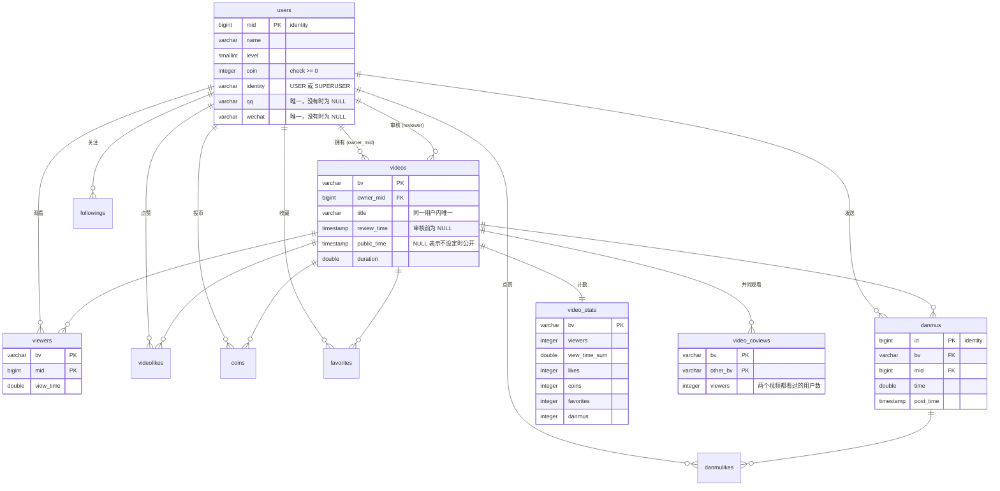

# 视频分享平台数据库系统

[English](README.md) | **中文**

一个仿 Bilibili 的视频网站的 PostgreSQL 后端：用户、视频、弹幕、点赞 / 投币 / 收藏、关注、搜索和推荐。Java 17、Spring Boot 2.7，用 JDBC 手写 SQL（没有用 ORM）。项目实现的是数据库课程框架里的服务接口，框架自带一个 23 步的基准测试，会检查每个答案，并对导入和其余 22 步中的 21 步计时。

2023 年的课程项目在 `main` 分支上，下面所有数字都以它为基线。2026 年我在这个分支（`optimize`）上重新做了一遍，改了表结构、查询和导入。

## 结果

两个版本在同一台机器、同一个 PostgreSQL 16 服务器上、同一次开机内交替运行，各 3 次，下面都是中位数（见[测试方法](#测试方法)）。

- 通过全部 **5,622** 个用例（2023 年的版本通过 5,618 个）。
- 10 个读取和推荐步骤：**20.0 s → 1.09 s（18.3×）**。相似视频和通用推荐快了 100 倍以上，个性化推荐 32×，好友推荐 22×，搜索 4.6×。
- 数据导入（约 820 万行）：**103.4 s → 9.6 s（10.7×）**。
- 全部 21 个计时步骤合计：**23.3 s → 4.9 s（4.8×）**。
- 11 个写入步骤**慢了 14.5%**（3.29 s → 3.77 s）。这是让读取变快的触发器和外键的代价，[写入路径](#写入路径)里有拆解。
- **修掉了并发问题。** 8 线程压力测试中，2023 年的版本在 45 次试验里 45 次都让用户花掉了自己没有的硬币，现在是 0 次。我自己的第一版重写在 45 次里 45 次丢失点赞和关注的切换，交叉删除账号时还会死锁，现在都是 0 次。
- 150 个测试（JUnit 5），其中 116 个是用 Testcontainers 跑在 PostgreSQL 16 上的集成测试，在 JDK 17 和 21 上都能通过。CI 工作流（`.github/workflows/ci.yml`）在这两个 JDK 上跑同样的构建。

也不是所有步骤都变快了：按中位数，有 11 个步骤各慢了 2–147 ms，包括 11 个写入步骤中的 9 个，以及两个最便宜的读取（热点 13 → 23 ms，弹幕显示 46 → 89 ms）。

> `io.sustc.service` 里的接口、`io.sustc.dto` 里的 DTO 以及整个 `sustc-runner` 模块（命令行和基准测试）来自 MIT 许可的课程框架（见 [LICENSE](LICENSE)），基准测试的逻辑和数据我都没有改。我写的部分是 `sustc-api/src/main/java/io/sustc/service/impl/`、`sql/` 里的 SQL、测试、脚本和文档。

更详细的说明（每个改动一节，附关键的 EXPLAIN 计划）：[docs/ENGINEERING_NOTES.md](docs/ENGINEERING_NOTES.md)。

## 架构


- **服务**是用构造器注入的 Spring bean（`NamedParameterJdbcTemplate`、`Authenticator`、`Clock`）。`Clock` 让"现在"可以测试，基准测试把它固定在数据生成的时刻。如果要在上面加 REST 层，需要注意的地方写在 [docs/DEVELOPMENT.md](docs/DEVELOPMENT.md#adding-a-rest-layer)。
- **每次写入都是认证之后的一个原子批次。** 投币、审核、编辑和级联删除都是单条语句（修改数据的 CTE、`ON CONFLICT`、外键级联）。切换类操作是"对用户加 advisory lock + 切换语句"，在一次往返里发出去，所以不需要显式事务。万一还是遇到死锁，会重试（最多 3 次）。
- **派生数据放在数据库里。** 每个视频的计数（`video_stats`）和共同观看数（`video_coviews`）由语句级触发器维护，所以推荐只需要读几十行，而不是每次都聚合 220 万条交互记录。
- **导入**用 `COPY` 批量加载，之后再建索引和约束；任何一步失败，导入的表都会被清空，表结构保持完整。

## 数据库设计

表结构：[`sql/build.sql`](sql/build.sql)。审计日志：[`sql/audit.sql`](sql/audit.sql)。角色示例：[`sql/usercontrol.sql`](sql/usercontrol.sql)。



每张关系表都以 `(对象, 用户)` 为主键，所以"用户 U 有没有赞过视频 V"就是一次主键查找。外键都是级联删除，删除用户或视频时，所有引用它的数据会在同一条语句里一起删掉（2023 年的代码会留下弹幕点赞和部分交互记录）。实数用 `double precision`；空的 QQ / 微信号存成 `NULL`，这样唯一约束只对真正填了的用户生效。

每个索引都是为某个具体查询加的（执行计划在 [docs/explain](docs/explain)）：

| 索引 | 用途 |
|---|---|
| `followings (follower_mid, followee_mid)` 主键 | 用户关注了谁；互关判断 |
| `followings (followee_mid, follower_mid)` | 用户的粉丝；好友推荐用它做仅索引扫描（2023 年的计划要扫全部 600 万行） |
| `viewers / videolikes / coins / favorites (bv, mid)` 主键 | "U 有没有看过 / 赞过……V"，以及每个视频的列表 |
| 同样四张表上的 `(mid, bv)` | 用户做过的所有事（用户信息、删除账号、好友看过的视频），都是仅索引扫描 |
| `videos (owner_mid, title)` 唯一 | 规范要求"同一用户不能有同名视频" |
| `danmus (bv, time)` | 按时间顺序取某个视频一段时间内的弹幕 |
| `danmus (mid)`、`danmulikes (mid)`、`videos (reviewer)` | 删除用户时的级联 |
| `video_coviews (bv, other_bv)` 主键、`(other_bv)` | 相似视频：一次索引查找，再取前 5 个 |

**派生表。** `video_stats` 存每个视频的各项计数和观看时长之和；`video_coviews` 对每一对有序的视频，存同时看过这两个视频的用户数。语句级 `AFTER` 触发器配合转换表，把一整条语句的变化用一条 `INSERT … ON CONFLICT DO UPDATE` 按主键顺序写进去，所以同一个触发器的两次触发会按相同顺序锁住共享的行。导入时这两张表在 Java 里算好，再像其他表一样用 `COPY` 加载。有一个测试会回放随机的工作负载，然后和从头重算的结果对比。

**审计和角色。** `audit.sql` 记录 `users` 上的每次插入、更新和删除（带角色和时间，但不记录密码、`qq` 和 `wechat`）。它是变更日志，不是防篡改的审计记录。`usercontrol.sql` 是一个可选的三角色示例，服务和测试都不用它；它不适合作为真正的终端用户配置（没有行级安全）。

## 性能

### 结果

<!-- benchmark-table:start -->
| 步骤 | 基线 ms (n=3) | 优化后 ms (n=3) | 加速比 | 通过数（基线 → 优化后） |
|---|---:|---:|---:|---:|
| 1 数据导入 | 103,387 [101,273–106,993] | 9,648 [9,335–9,816] | **10.7×** | – |
| 2 搜索视频 | 313 [282–340] | 68 [56–72] | **4.6×** | 18 → 20 / 20 |
| 3 平均观看率 | 55 [52–59] | 17 [16–19] | **3.2×** | 60 → 61 / 61 |
| 4 弹幕热点 | 13 [12–20] | 23 [17–24] | 0.57× | 56 → 56 / 56 |
| 5 相似视频 | 2,444 [2,249–3,036] | 18 [15–21] | **135.8×** | 43 → 43 / 43 |
| 6 通用推荐 | 1,025 [1,023–1,621] | 6 [5–9] | **170.8×** | 11 → 11 / 11 |
| 7 个性化推荐 | 1,977 [1,949–2,474] | 62 [55–65] | **31.9×** | 27 → 27 / 27 |
| 8 好友推荐 | 13,694 [12,493–14,549] | 616 [609–661] | **22.2×** | 142 → 142 / 142 |
| 9 弹幕展示 | 46 [43–54] | 89 | 0.52× | 382 → 382 / 382 |
| 10 发送弹幕 | 228 [218–240] | 322 [299–387] | 0.71× | 1016 → 1016 / 1016 |
| 11 用户信息 | 330 [276–365] | 183 [129–202] | **1.8×** | 500 → 500 / 500 |
| 12 弹幕点赞 | 不计时 | 不计时 | – | 500 → 500 / 500 |
| 13 投币 | 636 [566–676] | 569 [560–724] | **1.1×** | 511 → 511 / 511 |
| 14 点赞 | 636 [534–657] | 743 [742–1,006] | 0.86× | 686 → 686 / 686 |
| 15 收藏 | 569 [539–584] | 716 [618–741] | 0.79× | 644 → 644 / 644 |
| 16 发布视频 | 58 [39–69] | 68 [58–71] | 0.85× | 184 → 184 / 184 |
| 17 注册 | 121 [90–124] | 112 [86–113] | **1.1×** | 273 → 273 / 273 |
| 18 更新视频 | 22 [22–30] | 30 [22–32] | 0.73× | 184 → 184 / 184 |
| 19 审核 | 23 [19–23] | 26 [20–38] | 0.88× | 35 → 35 / 35 |
| 20 更新后搜索 | 136 [105–173] | 11 [9–14] | **12.4×** | 5 → 6 / 6 |
| 21 删除视频 | 492 [444–586] | 635 [569–666] | 0.77× | 55 → 55 / 55 |
| 22 删除账号 | 451 [427–478] | 490 [409–491] | 0.92× | 199 → 199 / 199 |
| 23 关注 | 58 [51–59] | 60 [55–70] | 0.97× | 87 → 87 / 87 |
| **读步骤 2–9、11、20 合计** | **20,033** | **1,093** | **18.3×** | |
| **写步骤 10、13–19、21–23 合计** | **3,294** | **3,771** | 0.87× | |
| **全部 21 个计时步骤合计** | **23,327** | **4,864** | **4.8×** | |
| **全部测试用例** | | | | **5618 → 5622 / 5622** |
<!-- benchmark-table:end -->

由 `python3 scripts/bench_table.py --write README.md README.zh-CN.md` 根据 [docs/benchmark/round3/plain](docs/benchmark/round3/plain) 里的原始报告生成（`c6-B<i>.json` 是 2023 年的版本，`c6-O<i>.json` 是这个版本，运行顺序 B1、O1、B2、O2、B3、O3）。时间是 3 次运行的中位数，方括号里是范围。第 12 步框架不计时。

### 关键改动

| 改动 | 效果 |
|---|---|
| 在 `video_coviews` 里维护共同观看数 | 相似视频：2023 年的代码每次调用都要对 87.5 万行的 `viewers` 表做自连接；现在从索引里读出该视频的 43 行再排序。第 5 步：2,444 → 18 ms。 |
| 在 `video_stats` 里维护每个视频的计数 | 通用推荐：2023 年的代码每次都要聚合五张交互表（共 220 万行）；现在只连接两张 44 行的表。第 6 步：1,025 → 6 ms。没有好友的用户，个性化推荐会回退到这里；第 7 步：1,977 → 62 ms。 |
| 覆盖索引 `followings (followee_mid, follower_mid)` 加上重写的好友查询 | 第 8 步：13,694 → 616 ms。我也确认了不只是缺统计信息的问题：导入后马上 `VACUUM ANALYZE`，2023 年的代码用同样的计划仍然要 11.4–12.2 s。 |
| 搜索用 `replace()` 计数，观看数从 `video_stats` 读 | 第 2 步：313 → 68 ms。2023 年的代码会连接每个匹配视频的每一次观看，还把关键词当成正则表达式。 |
| `COPY … FREEZE` 批量导入，之后再建索引和约束，外键并行校验 | 第 1 步：103.4 s → 9.6 s（加载 2.8 s，索引 5.1 s，约束 1.5 s，vacuum/analyze 0.2 s）。 |

前后的执行计划在 [docs/explain](docs/explain)（`EXPLAIN (ANALYZE, BUFFERS)`，由 `scripts/explain_plans.sh` 重新生成）。

### 写入路径

写入变慢了，所以我去测了时间到底花在哪里，而不是靠猜（[详细说明](docs/ENGINEERING_NOTES.md#the-write-path)）：

- **不是磁盘回写。** 写入步骤开始时，我这边的运行里内核只有 0.6–1.6 MB 脏数据。
- **导入之后的 checkpoint 约占 5%。** 导入后执行 `CHECKPOINT` 并等一会儿，写入步骤是 3,189 ms，2023 年的代码是 2,892 ms。
- **全页镜像：多了 6.5%。** `danmus` 指向 `users` 的外键会锁住每个发送者的行，而 checkpoint 之后对某个页面的第一次加锁会把整页写进 WAL（[fk-lock-wal.txt](docs/experiments/fk-lock-wal.txt)）。
- **剩下的是每次调用本身的开销。** 用 pgbench 测，一次点赞的触发器约 0.13 ms，外键约 0.09 ms（[write-latency.txt](docs/experiments/write-latency.txt)）。

为了单独看每种写入操作，我写了 WriteBench：它通过任一版本 jar 的服务层，在基准数据上调用每种写入，每种 600 次，每个版本交替跑 3 次（[汇总](docs/benchmark/round3/writebench/summary.md)）。p50 的中位数，单位 ms，2023 年的代码 → 这个版本：

| 操作 | 1 个客户端 | 8 个客户端 | 8 个客户端时吞吐量 本版本 / 2023 | 每次调用的语句数 / 往返次数 |
|---|---:|---:|---:|---:|
| 投币 | 1.40 → 1.03 | 2.47 → 2.47 | 0.96 | 7 / 7 → 2 / 2 |
| 点赞视频 | 0.82 → 0.98 | 1.54 → 2.22 | 0.78 | 5 / 5 → 3 / 2 |
| 收藏 | 0.87 → 0.93 | 1.78 → 2.20 | 0.85 | 5 / 5 → 3 / 2 |
| 发送弹幕 | 0.92 → 1.03 | 2.10 → 2.20 | 0.90 | 5.05 / 5.05 → 2 / 2 |
| 点赞弹幕 | 0.81 → 0.74 | 1.49 → 2.01 | 0.79 | 5 / 5 → 3 / 2 |
| 发布视频 | 0.80 → 0.91 | 1.41 → 1.78 | 0.90 | 4 / 4 → 2 / 2 |
| 注册 | 0.65 → 0.49 | 1.02 → 1.10 | 0.88 | 2 / 2 → 1 / 1 |
| 更新视频 | 0.64 → 0.93 | 1.28 → 1.48 | 0.94 | 4 / 4 → 2 / 2 |
| 审核 | 0.53 → 0.62 | 1.02 → 1.00 | 1.16 | 3 / 3 → 2 / 2 |
| 删除视频（无观看） | 1.15 → 1.33 | 2.67 → 2.17 | 1.30 | 9 / 9 → 3 / 2 |
| 删除视频（约 2 万次观看） | 26.14 → 53.52 | 133 → 297 | 0.38 | 9 / 9 → 3 / 2 |
| 删除账号 | 5.93 → 6.92 | 29.35 → 108 | 0.29 | 13 / 13 → 3 / 2 |
| 关注 | 0.69 → 0.75 | 1.56 → 1.82 | 0.90 | 4 / 4 → 3 / 2 |

**删除**是最难的部分。我第 2 轮的版本在 8 个客户端下，每次运行 100 个账号删除里有 79–87 个因为 `deadlock detected` 失败，原因是我自己写的触发器：删除是一张表一张表级联的，每张被级联的表的触发器都会锁住它那些视频的计数，所以两个删除可能以交叉的顺序去锁共享的计数。现在删除会先拿一把 advisory "删除锁"（只有调用者有权删除时才拿），删账号是排他锁，删视频是共享锁。8 个客户端下已经没有删除失败了（第 4 轮 300 个账号删除里 0 个失败），代价是账号删除只能一个一个来：每秒 69.8 个，2023 年的版本是 306.2 个（0.23×）（[第 4 轮汇总](docs/benchmark/round4/writebench/summary.md)）。

### 测试方法

- **轮次。** 我是分轮迭代的：第 1 轮结束于 `978fe40`，第 2 轮结束于 `a330c0c`，第 3 轮结束于 `ac3a0dc`，也就是上面表格测的代码。第 4 轮只在最终代码上重跑了 WriteBench（8 客户端删除和压力模式）。之后的提交改了删除锁、`derived_viewers`、`truncate()` 和 `usercontrol.sql`。
- **机器。** 一台虚拟机（4 个 vCPU、15 GiB 内存），一个 PostgreSQL 16 服务器，所有运行用同样的配置（`shared_buffers` 1 GB，`synchronous_commit` 开，`full_page_writes` 开，`max_wal_size` 1 GB，`checkpoint_timeout` 5 分钟）。
- **基线。** 2023 年的版本是 `main` 上 `2e811bd` 的服务代码，从 `3796695`（分支 `bench/baseline-clock`）构建，这个分支只加了一个时钟偏移。两个 jar 自带的 JDBC 驱动不同（pgjdbc 42.3.8 和 42.7.4），驱动本身的影响我没有单独测。
- **时钟。** 每次运行都从新建的 schema 开始，运行未修改的框架基准测试，服务时钟固定在 2023-12-30 12:00 +08:00，也就是数据生成的时间，因为有几个用例会拿发布时间和"现在"比较。2023 年的版本失败的 4 个用例来自它自己的代码（三个关键词里有连续空格的搜索，一个因为观看时长用 `real` 求和而在第四位出错的观看率）。
- **顺序。** 每个版本 3 次，顺序为 B1、O1、B2、O2、B3、O3，都在同一次开机内。每次运行都持有一个锁文件，保证机器上的其他任务不会在运行期间插进来。没有丢弃任何一次运行。
- **之前的轮次。** [docs/benchmark/round1](docs/benchmark/round1) 里第 1 轮的运行两个版本相隔几个小时，已经不再引用。2023 年的版本也一轮比一轮慢（导入在第 1 轮是 57.7 s，第 3 轮是 101.3–107.0 s），这也是现在两个版本交替运行的原因之一。
- 脚本都在仓库里：`scripts/run_bench.sh` 运行一个 jar，`scripts/bench_instrumented.py` 监控一次运行（每步的 WAL、脏内存、checkpoint），`scripts/bench_series.sh` 交替运行一组，`scripts/compare.py` 比较报告。命令见 [docs/DEVELOPMENT.md](docs/DEVELOPMENT.md#commands)。

## 正确性

2023 年的版本有 4 个基准用例没通过，还有几个基准测试检查不到的 bug。这些都修好了，每个都有对应的测试：

- `follow` 返回调用之后的状态；删除账号会删掉该用户的视频及视频上的一切，以及该用户做过的一切；删除视频也会删掉它的弹幕点赞。
- 相似视频按 `bv` 打破平局；搜索统计不重叠、不区分大小写的出现次数（用 ICU，所以在 C locale 的数据库上非 ASCII 文本也没问题），再按观看数、然后按 `bv` 打破平局。
- 未审核的视频和还没到发布时间的视频，只有作者和超级用户能看到。
- 投币是一条语句，所以只有捐赠记录插入成功才会扣硬币（用 8 个并发线程测过）。切换、编辑和共同观看计数在并发下都是安全的。`ConcurrencyTest` 有 16 个测试，每个修复对应的测试在修复之前的代码上都会失败（[concurrency-tests-old-vs-new.txt](docs/experiments/concurrency-tests-old-vs-new.txt)、[deadlock-tests-old-vs-new.txt](docs/experiments/deadlock-tests-old-vs-new.txt)、[round4-tests-old-vs-new.txt](docs/experiments/round4-tests-old-vs-new.txt)）。
- 导入后 identity 序列会从导入的 id 之后继续；没有任何代码路径会泄漏连接池里的连接（每个集成测试之后都会检查）。

规范有歧义的地方，我的理解列在 [docs/ENGINEERING_NOTES.md](docs/ENGINEERING_NOTES.md#interpretations-of-the-specification)。

## 运行

需要 JDK 17 或 21，以及 Docker（测试需要，数据库也可以用它）。

```bash
# 构建并运行全部测试（需要 Docker：Testcontainers 会启动 PostgreSQL 16）
./gradlew build

# 为 runner 准备数据库（127.0.0.1:5432 上的 postgres:16-alpine；用户名、密码和数据库名都是 "sustc"）
# 端口 5432 被占用时：SUSTC_DB_PORT=55432 docker compose up -d，脚本则使用 PGPORT=55432。
cd sustc-runner && docker compose up -d && cd ..

# 课程提供的测试数据（.ser 文件，不在本仓库中）放到
#   sustc-runner/data/import/  和  sustc-runner/data/test/

# 在新建的 schema 上运行一次基准测试，结果写入 docs/benchmark/<label>.json
scripts/benchmark.sh --label my-run

# 根据 docs/benchmark/round3/plain/c6-B*.json 和 c6-O*.json 重新生成 README 中的表格
python3 scripts/bench_table.py --write README.md README.zh-CN.md

# 写入操作的微基准和压力测试（见 scripts/writebench/run.sh）
scripts/writebench/run.sh --jar run/sustc-runner.jar --sql "sql/build.sql sql/audit.sql" \
    --out result.json -- --mode steady --clients 1 --ops 600 --warmup 300 --settle

# 交互式命令行
./gradlew :sustc-runner:bootRun
```

## 限制与安全

- `scripts/benchmark.sh`、`scripts/explain_plans.sh`、`scripts/write_latency.sh` 和 `scripts/writebench/run.sh` 会**删除并重建目标数据库的 `public` schema**。除非传 `--allow-remote`，它们只接受本机回环地址。在共享机器上可以设置 `BENCH_LOCK`（或者用 `flock` 包一下）让计时运行互不干扰。
- WriteBench 最多 16 个客户端线程，每种操作最多 5,000 次调用。有几个脚本会通过 `sudo -u postgres` 执行 `CHECKPOINT` 和 `pg_waldump`。
- 对数据库的负载受连接池（HikariCP，默认 10 个连接）和导入并行度（默认 4 个连接）限制，没有其他网络流量。

## 已知局限

- 密码按提供的数据明文存储。审计日志已经不再复制密码，但旧版本写下的日志里还有。
- 账号删除只能一个一个来（见[写入路径](#写入路径)）。怎么让它们重新并发执行，还没解决（[待解决的问题](docs/ENGINEERING_NOTES.md#open-questions)）。
- 派生表的触发器需要 READ COMMITTED（PostgreSQL 的默认级别）；在 REPEATABLE READ 下 `derived_viewers` 会拒绝观看记录的变更，SERIALIZABLE 没有测过。
- 单行写入每次调用稍微贵一点，1 个客户端时最多多 0.29 ms；删除一个约 2 万次观看的视频要花两倍时间（26.14 → 53.52 ms）。
- 对 N 个视频，`video_coviews` 最多有 N(N−1) 行。对这个规模没问题（44 个视频的 1,892 对全都存在），但视频多了就需要改成无序对，或者给每个用户设上限。
- 在新启动的 JVM 里，弹幕显示的前几次调用比较慢，而基准测试只计第一轮（[说明](docs/ENGINEERING_NOTES.md#hotspots-and-danmu-display)）。
- 推荐不按可见性过滤，规范没有要求。
- 每次服务调用都会单独查询一次来认证；把认证合并进语句里，每次调用可以省一次往返。
