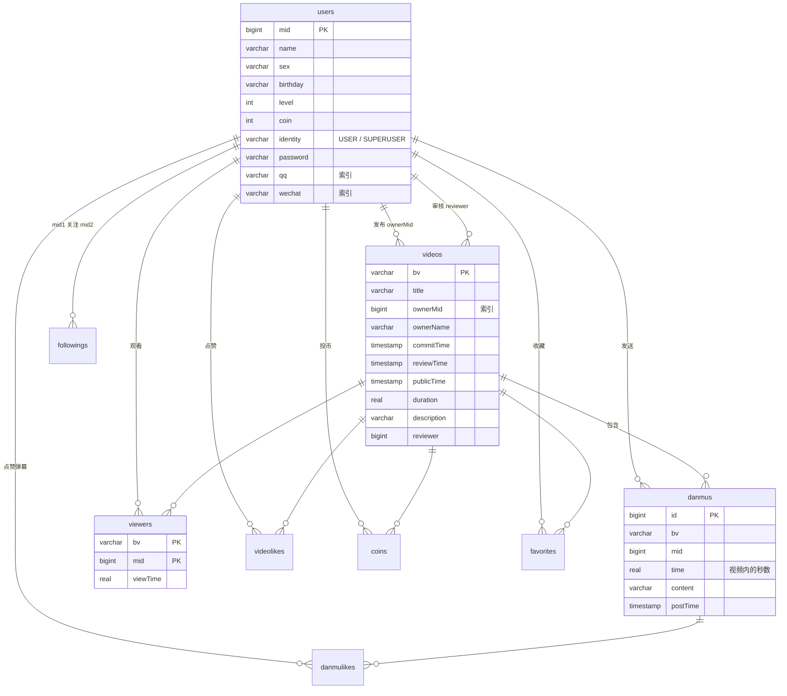

# Video-Sharing Platform Database System

[English](README.md) | **中文**

一个仿 B 站的视频平台数据库后端：用户、视频、弹幕、点赞/投币/收藏、关注关系，以及基于 SQL 的搜索与推荐。

- **技术栈**：Java 17+ · Spring Boot 2.7 · 原生 JDBC（不使用 ORM）· HikariCP · PostgreSQL 15/16 · Gradle
- **代码规模**：5 个 Service 实现类，约 2500 行 Java；核心查询全部手写 SQL
- **测试结果**：框架自带的 benchmark 23 项共 5622 个用例，通过 5618 个（99.9%）

> 接口定义 `io.sustc.service.*`、DTO `io.sustc.dto.*`，以及整个 `sustc-runner` 模块（命令行和 benchmark）来自一个已有的项目框架（MIT 许可，见 [LICENSE](LICENSE)）。
> 我负责的部分是 `sustc-api/src/main/java/io/sustc/service/impl/` 下的全部实现，以及 `sql/` 下的建表、审计、权限脚本。

---

## 目录

- [架构](#架构)
- [数据库设计](#数据库设计)
- [功能](#功能)
- [性能优化](#性能优化)
- [Benchmark 结果](#benchmark-结果)
- [运行方式](#运行方式)
- [已知不足](#已知不足)

## 架构

```
sustc-runner (项目框架)                 sustc-api (本人实现)
┌──────────────────────────┐           ┌─────────────────────────────────┐
│ Spring Shell 命令行       │  调用接口  │ UserServiceImpl                 │
│ BenchmarkService          │ ────────▶ │ VideoServiceImpl                │      JDBC
│ (反序列化测试数据并校验)   │           │ DanmuServiceImpl                │ ───────────▶ PostgreSQL
└──────────────────────────┘           │ RecommenderServiceImpl          │
                                        │ DatabaseServiceImpl (导入数据)  │
                                        │ AuthHelper (登录与身份校验)     │
                                        └─────────────────────────────────┘
```

`sustc-api` 打成一个 jar，由 `sustc-runner` 加载。`sustc-runner` 通过 Spring 注入的 `DataSource`（HikariCP 连接池）访问数据库，并发调用各个接口，再把返回结果和标准答案比对。

## 数据库设计

建表脚本：[`sql/build.sql`](sql/build.sql)



设计要点：

- **3 张实体表**：`users`、`videos`、`danmus`。
- **6 张关系表**：`followings`、`viewers`、`videolikes`、`coins`、`favorites`、`danmulikes`。原始数据里的"点赞列表""关注列表"等数组字段，都拆成了 `(用户, 对象)` 联合主键的关系表，符合第三范式，"是否已点赞"这类判断走主键索引就能完成。
- `viewers` 额外存了观看时长 `viewTime`，用来计算平均观看率和推荐评分。
- 关系表的两列各建一个单列索引，分别对应"某视频的所有点赞"和"某用户的所有点赞"两个查询方向。
- `users.qq` 和 `users.wechat` 建了索引，用于第三方登录（详见[性能优化](#性能优化)）。

另外还有两个脚本：

- **审计**：[`sql/audit.sql`](sql/audit.sql) 在 `users` 表上建了一个 `AFTER INSERT/UPDATE/DELETE` 行级触发器，把每次改动连同操作人、时间写进 `log_users`。
- **权限**：[`sql/usercontrol.sql`](sql/usercontrol.sql) 建了三个数据库角色，权限依次递减：超级管理员有全部权限；管理员可以增删改查所有业务表；普通用户只能读，以及写互动类表（弹幕、点赞、收藏等）。

## 功能

| 模块 | 接口 | 实现要点 |
|---|---|---|
| 数据导入 | `importData` | PreparedStatement 批量插入，主线程加 4 个工作线程，各用一个连接并行导入不同的表 |
| 用户 | `register` `deleteAccount` `follow` `getUserInfo` | 支持 mid+密码 / QQ / 微信三种登录方式；普通用户只能注销自己，超级管理员可以注销普通用户；注销时级联删除该用户的所有互动记录 |
| 视频 | `postVideo` `updateVideoInfo` `deleteVideo` `reviewVideo` | 已审核过的视频修改后要重新审核；只有超级管理员能审核视频，且不能审核自己的 |
| 互动 | `likeVideo` `coinVideo` `collectVideo` | 只能对自己能搜到的视频操作；投币扣除硬币且不可撤回；点赞和收藏再操作一次即取消 |
| 搜索 | `searchVideo` | 在一条 SQL 里统计每个关键词在标题、简介、UP 主名中的出现次数（`regexp_split_to_array`），按相关度和播放量排序，在数据库内分页 |
| 统计 | `getAverageViewRate` `getHotspot` | 热点：视频按 10 秒切片，弹幕最多的切片即热点 |
| 弹幕 | `sendDanmu` `displayDanmu` `likeDanmu` | 必须看过视频才能发弹幕；按时间范围显示弹幕，可选去掉重复内容 |
| 推荐 | `recommendNextVideo` | 相似度 = 同时看过两个视频的用户数（`viewers` 自连接） |
| | `generalRecommendations` | 热度 = 点赞率 + 投币率 + 收藏率 + 人均弹幕数 + 完播率，五个子查询分别聚合后合并 |
| | `recommendVideosForUser` | 好友 = 互相关注的人（`followings` 自连接），推荐好友看过而自己没看过的视频；没有可推荐的就退回热门推荐 |
| | `recommendFriends` | 按共同关注数推荐还没关注的用户 |

## 性能优化

以下数据是 2023 年在本机实测的结果。

| 优化 | 做法 | 效果 |
|---|---|---|
| 批量插入 | 用一条预编译语句加 `addBatch` / `executeBatch` 一次性提交，代替逐条执行 SQL | 导入耗时降低约 **30%**（两次测试：176.6s → 121.8s，494.4s → 346.7s） |
| 多线程导入 | 9 张表之间没有外键依赖，拆成 5 组，由 5 个连接并行导入 | 在批量插入的基础上再降低 **38%**（121.8s → 75.4s） |
| 登录索引 | 第三方登录要按 `qq`、`wechat` 查找用户，给这两列加了索引 | 1016 次登录查询的总耗时 602ms → 38ms，约 **16 倍** |
| 在数据库里计算 | 搜索的相关度、推荐的评分、排序和分页都在 SQL 里完成，只把最终那一页的 bv 返回给 Java | 避免把大结果集传到应用层 |

## Benchmark 结果

benchmark 一共 23 步。第 1 步导入约 3.8 万用户、数十万条观看和互动记录（测试数据不在本仓库中），之后 22 步并发调用各接口，并和标准答案比对。

| # | 测试项 | 通过 / 总数 | 耗时 (ms) | 参考实现耗时 (ms) |
|---|---|---|---|---|
| 1 | 导入数据 | — | 76,115 | 281,878 |
| 2 | 视频搜索 | 18 / 20 | 792 | 219 |
| 3 | 平均观看率 | 60 / 61 | 76 | 47 |
| 4 | 热点切片 | 56 / 56 | 11 | 10 |
| 5 | 相似视频推荐 | 43 / 43 | 4,687 | 1,815 |
| 6 | 热门推荐 | 11 / 11 | 1,467 | 944 |
| 7 | 个性化推荐 | 27 / 27 | 2,770 | 2,844 |
| 8 | 好友推荐 | 142 / 142 | 15,650 | 7,900 |
| 9 | 显示弹幕 | 382 / 382 | 25 | 18 |
| 10 | 发送弹幕 | 1016 / 1016 | 94 | 44 |
| 11 | 用户信息 | 500 / 500 | 364 | 247 |
| 12 | 弹幕点赞 | 500 / 500 | — | — |
| 13 | 投币 | 511 / 511 | 553 | 163 |
| 14 | 点赞 | 686 / 686 | 577 | 193 |
| 15 | 收藏 | 644 / 644 | 506 | 169 |
| 16 | 发布视频 | 184 / 184 | 40 | 39 |
| 17 | 注册 | 273 / 273 | 50 | 42 |
| 18 | 修改视频信息 | 184 / 184 | 52 | 44 |
| 19 | 审核视频 | 35 / 35 | 19 | 12 |
| 20 | 修改和审核后再搜索 | 5 / 6 | 292 | 54 |
| 21 | 删除视频 | 55 / 55 | 400 | 376 |
| 22 | 注销用户 | 199 / 199 | 301 | 147 |
| 23 | 关注 | 87 / 87 | 45 | 27 |

- "通过 / 总数"和"耗时"两列是 2023 年版本的结果，原始文件见 [`docs/benchmark/original-result.json`](docs/benchmark/original-result.json)。
- 参考实现的数据随框架一起提供，见 [`docs/benchmark/reference-standard.json`](docs/benchmark/reference-standard.json)。两者不是在同一台机器上测的，耗时只能粗略比较。
- 第 12 步的耗时框架没有记录。

## 运行方式

需要 JDK 17 或 21、Docker（或者自己装的 PostgreSQL 15+）。

```bash
# 1. 启动数据库（用户名、密码、库名都是 sustc，和 application.yml 的默认值一致）
cd sustc-runner && docker compose up -d && cd ..

# 2. 建表
psql -h localhost -U sustc -d sustc -f sql/build.sql

# 3. 把测试数据（.ser 文件，不在本仓库中）放到 sustc-runner/data/import/ 和 sustc-runner/data/test/

# 4. 运行 benchmark，结果写到 sustc-runner/benchmark-<id>-<时间戳>.json
./gradlew :sustc-runner:benchmark

# 或者启动交互式命令行，手动调用各接口
./gradlew :sustc-runner:bootRun
```

> 如果项目路径里有中文，Lombok 插件可能报 `MalformedInputException`。可以加上
> `"-Dorg.gradle.jvmargs=-Dfile.encoding=UTF-8 -Dsun.jnu.encoding=UTF-8"` 参数，或者把项目放到纯英文路径下。

把 `sustc-api` 单独打包成 jar：`./gradlew :sustc-api:submitJar`，输出在 `submit/sustc-api.jar`。

## 已知不足

- **没有使用事务**：注销账号、删除视频要执行多条 DELETE，中途出错会只删一半；投币是"先查再写"两步，高并发下可能重复扣币。应该把这些操作放进事务，或者用带条件的 UPDATE。
- **连接没有统一用 try-with-resources 管理**：大多数方法在抛异常时会泄漏数据库连接。
- **搜索**：没有过滤未审核的视频，关键词里的正则特殊字符也只转义了一部分。第 2、20 步没全过，很可能就是这两个原因（未逐个验证）。
- **推荐**：相似视频推荐缺少"相同时按 bv 升序"的次要排序；热门推荐里的人均弹幕数不应该截到 1。
- **数据库设计**：没有外键和 NOT NULL 约束，级联删除全靠应用层代码；`danmus.bv` 没有索引；新用户 mid 和弹幕 id 用随机数生成，应该改用 sequence。
- **安全**：密码明文存储（测试数据本身就是明文）。
- **导入**：主线程靠轮询一个普通数组来判断导入线程是否结束，应该改用 `Thread.join()` 或 `ExecutorService`；只要一个线程抛异常，主线程就会一直卡住。
